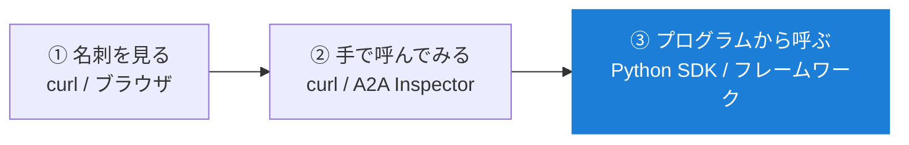
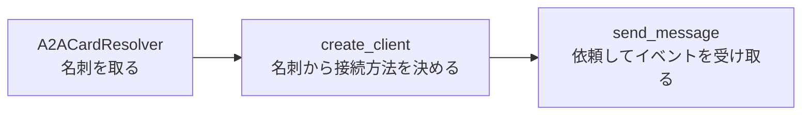

# A2A を使ってみる

<p class="oneliner">ユーザーとして A2A を使うとは、<b>誰かが公開している A2A エージェントを見つけて、呼び出し、結果を受け取る</b>ことです。</p>

## 使い方は 3 段階



## ① 名刺を見る

A2A エージェントの URL が分かったら、まず名刺を取ってきます。

```bash
curl -s https://エージェントのホスト/.well-known/agent-card.json | jq
```

!!! tip "名刺のチェックポイント"
    - [x] `skills`: 頼みたいことができそうか
    - [x] `supportedInterfaces`: 接続先 URL と方式 (`JSONRPC` / `GRPC` / `HTTP+JSON`)、`protocolVersion`
    - [x] `capabilities`: ストリーミング・プッシュ通知が使えるか
    - [x] `securitySchemes`: どんな認証が必要か
    - [x] `defaultInputModes` / `defaultOutputModes`: テキストを送れるか、何が返ってくるか

## ② 手で呼んでみる

JSON-RPC 方式のエージェントなら、curl だけで呼べます。

```bash
curl -s https://エージェントのURL \
  -H 'Content-Type: application/json' \
  -H 'A2A-Version: 1.0' \
  -d '{
    "jsonrpc": "2.0", "id": 1, "method": "SendMessage",
    "params": { "message": {
      "role": "ROLE_USER", "messageId": "m1",
      "parts": [ { "text": "hello" } ]
    } }
  }'
```

??? success "返ってくるもの (例: 受け取った文章をそのまま返すエージェント)"
    ```json
    {"result":{"task":{
      "id":"d4021e21-...","contextId":"907d4771-...",
      "status":{"state":"TASK_STATE_COMPLETED","timestamp":"2026-10-24T06:32:24.182075Z"},
      "artifacts":[{"artifactId":"a63f2d70-...","parts":[{"text":"echo: hello","mediaType":"text/plain"}]}],
      "history":[ ... ]
    }},"id":1,"jsonrpc":"2.0"}
    ```

!!! failure "ハマりどころ: `A2A-Version` ヘッダーを付け忘れる"
    このヘッダーが無いと、相手は**古い v0.3 として扱います**。v1.0 にしか対応していないエージェントからは、次のエラーが返ってきます。

    ```json
    {"error":{"code":-32009,
      "message":"A2A version '0.3' is not supported by this handler. Expected version '1.0'."}}
    ```

    名刺の `protocolVersion` を見て、合わせたバージョンをヘッダーで伝えましょう。

!!! example "画面で試したいなら: A2A Inspector"
    公式の **A2A Inspector** を使うと、URL を入れるだけで名刺の確認・メッセージ送信・やり取りの JSON の確認がブラウザ上でできます。

## ③ プログラムから呼ぶ (Python)

公式の Python SDK を使います。

```bash
pip install a2a-sdk
```

```python
--8<-- "a2a/real_client.py:client"
```

??? success "実行結果 (ストリーミングで 4 つのイベントが届く)"
    ```text
    相手: Echo / スキル: ['Echo']
    task { id: "8f3e..." status { state: TASK_STATE_SUBMITTED } history { ... } }
    status_update { task_id: "8f3e..." status { state: TASK_STATE_WORKING ... } }
    artifact_update { task_id: "8f3e..." artifact { parts { text: "echo: こんにちは" } } }
    status_update { task_id: "8f3e..." status { state: TASK_STATE_COMPLETED } }
    ```

    [タスクのライフサイクル](task.md) で見た「ストリーミング」の流れが、そのまま届いているのが分かります。



!!! info "フレームワークから使う"
    Google ADK、LangGraph、BeeAI、Microsoft Agent Framework など、多くのエージェントフレームワークが A2A に対応しています。
    多くの場合「**リモートエージェントの URL (名刺の場所) を登録すると、自分のエージェントの部下 (サブエージェント) として使える**」形になっています。

    ```mermaid
    flowchart LR
        Me["自分のエージェント<br/>(フレームワーク)"] -->|"サブエージェントとして登録"| R1["A2A: 翻訳エージェント"]
        Me --> R2["A2A: 経費精算エージェント"]
        Me --> L["ローカルの道具 (MCP)"]
    ```

## 使うときに気をつけること

| 項目 | 気をつけること |
|---|---|
| **バージョン** | v0.3 と v1.0 で操作名・値の書き方が違う (`message/send` → `SendMessage`、`completed` → `TASK_STATE_COMPLETED`) |
| **名刺の場所** | 古い記事では `/.well-known/agent.json` のことがある。今は `agent-card.json` |
| **認証** | 名刺の `securitySchemes` に従い、トークンは **HTTP ヘッダー**で送る。メッセージ本文に入れない |
| **信頼** | 相手は中身の見えない他人。**返ってきた内容をそのまま実行しない**。署名つきの名刺 (JWS) なら発行元を確認できる |
| **待ち方** | 長くかかる仕事は、ブロッキングで待たずにストリーミングかプッシュ通知を使う |

!!! abstract "この章のまとめ"
    - まず**名刺**を見て、頼めるか・どう話すかを確認する。
    - curl なら **`A2A-Version: 1.0` ヘッダーを忘れずに**。
    - Python なら `a2a-sdk` の `A2ACardResolver` → `create_client` → `send_message`。
    - 相手は**他人**。認証と、返ってきた内容の扱いに気をつける。

[次へ: 第 4 章 AHP :material-arrow-right:](../ahp/index.md){ .md-button .md-button--primary }
