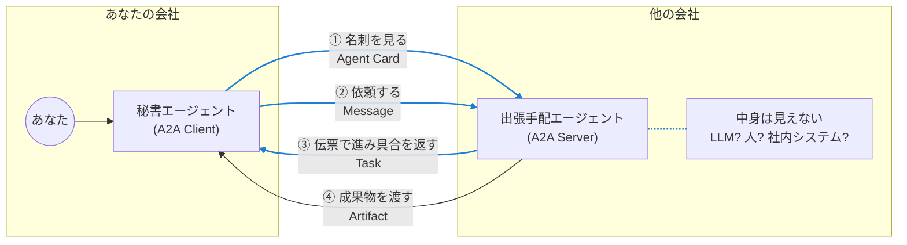
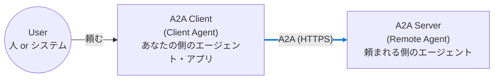
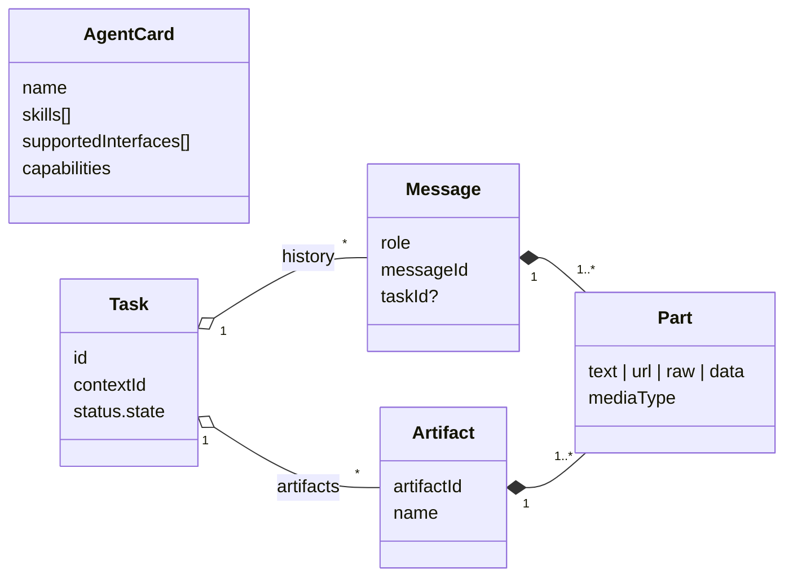

# A2A の概要

<p class="oneliner"><span class="badge a2a">A2A</span> <b>Agent2Agent Protocol</b> は、<b>中身の見えない他人のエージェント</b>に仕事を頼むための共通の約束です。「外注先への発注窓口」と考えると分かりやすいです。</p>

## 人間の仕事に例えると



!!! info "A2A の最大の特徴: 相手は opaque (中が見えない)"
    A2A では、相手のエージェントが**どの LLM を使い、どんな道具を持ち、どう考えているか**は分かりません。分かるのは、名刺に書かれた「**何ができるか**」だけです。
    だから、**別の会社・別のチーム・別のフレームワーク**で作られたエージェントとも協力できます。

## 登場人物



A2A Server も、裏で別のエージェントに A2A で頼めます。**頼む・頼まれるは役割**であって、エージェントの種類ではありません。

## 5 つの部品

<div class="cards" markdown>
<div class="a2a" markdown>
<span class="big">🪪</span> **Agent Card**

名刺。名前・できること (スキル)・接続先・認証方法
</div>
<div class="a2a" markdown>
<span class="big">💬</span> **Message**

1 回分の発言。`ROLE_USER` か `ROLE_AGENT`
</div>
<div class="a2a" markdown>
<span class="big">🧩</span> **Part**

発言や成果物の中身。テキスト・ファイル・構造化データ
</div>
<div class="a2a" markdown>
<span class="big">🧾</span> **Task**

仕事の伝票。ID と状態 (作業中・完了など) を持つ
</div>
<div class="a2a" markdown>
<span class="big">📦</span> **Artifact**

成果物。レポート・画像・JSON など
</div>
</div>

部品同士の関係は次のとおりです。



!!! tip "Message と Artifact の違い"
    - **Message** = やり取りの**会話** (「日付はいつですか?」「10 月 30 日です」)
    - **Artifact** = 仕事の**成果物** (旅程表の JSON、PDF のレポート)

    納品物を会話に埋もれさせず、きちんと取り出せるように分けてあります。

## 名刺 (Agent Card) を見てみる

エージェントは、決まった場所 **`/.well-known/agent-card.json`** で名刺を公開します。

```js title="https://travel.example.com/.well-known/agent-card.json"
{
  "name": "Travel Agent",
  "description": "出張の航空券とホテルを手配します",
  "version": "1.2.0",
  "supportedInterfaces": [
    { "url": "https://travel.example.com/a2a",           // (1)!
      "protocolBinding": "JSONRPC", "protocolVersion": "1.0" }
  ],
  "capabilities": { "streaming": true, "pushNotifications": false }, // (2)!
  "securitySchemes": { "oauth": { "...": "..." } },      // (3)!
  "defaultInputModes": ["text/plain"],
  "defaultOutputModes": ["application/json"],
  "skills": [                                             // (4)!
    { "id": "book-trip", "name": "出張手配",
      "description": "行き先と日付から航空券とホテルを手配",
      "tags": ["travel"], "examples": ["来週の大阪出張を手配して"] }
  ]
}
```

1. **どこに・どの方式で**話しかければよいか。JSON-RPC / gRPC / HTTP+JSON (REST) の 3 方式があります。
2. **途中経過を流せるか** (streaming)、**後から通知してくれるか** (push notifications)。
3. **認証の方法**。OAuth 2.0、API キー、mTLS など、ふつうの Web の仕組みを使います。
4. **何を頼めるか**。人間にも LLM にも読めるように、説明と例文が書かれています。

コードで表すと、次のようになります。

```python
--8<-- "a2a/a2a_model.py:card"
```

## A2A の窓口

```python
--8<-- "a2a/a2a_model.py:protocols"
```

| v1.0 の操作名 | 意味 |
|---|---|
| `SendMessage` | 依頼する (結果を 1 回で受け取る) |
| `SendStreamingMessage` | 依頼する (途中経過を流してもらう) |
| `GetTask` / `ListTasks` | 伝票の状態を見る |
| `CancelTask` | 依頼を取り消す |
| `SubscribeToTask` | 実行中の伝票の途中経過を (再) 購読する |
| `GetExtendedAgentCard` | ログインした人だけに見せる、詳しい名刺をもらう |

!!! abstract "このページのまとめ"
    - A2A = **中身の見えない他人のエージェント**に仕事を頼む約束。
    - 名刺 (**Agent Card**) で相手を知り、**Message** で頼み、**Task** で追いかけ、**Artifact** を受け取る。
    - 運び方は **HTTPS**。認証もふつうの Web の仕組みを使う。

[次へ: タスクのライフサイクル :material-arrow-right:](task.md){ .md-button .md-button--primary }
