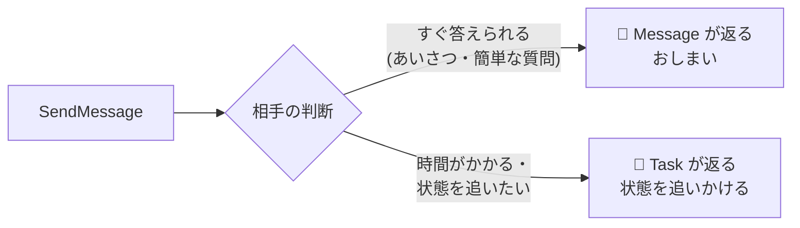
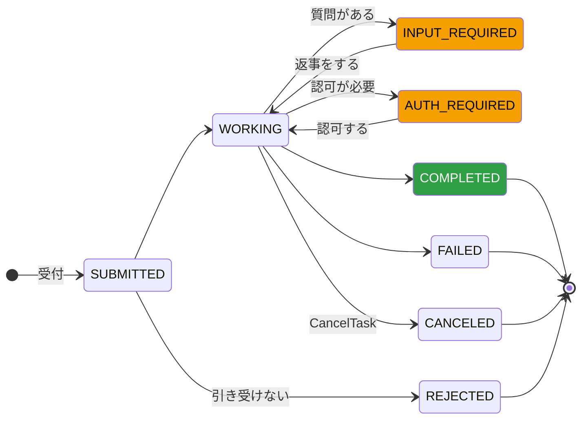
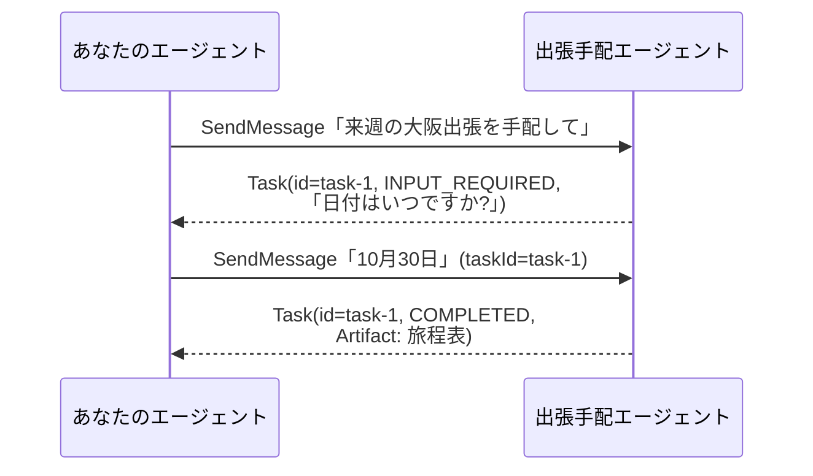
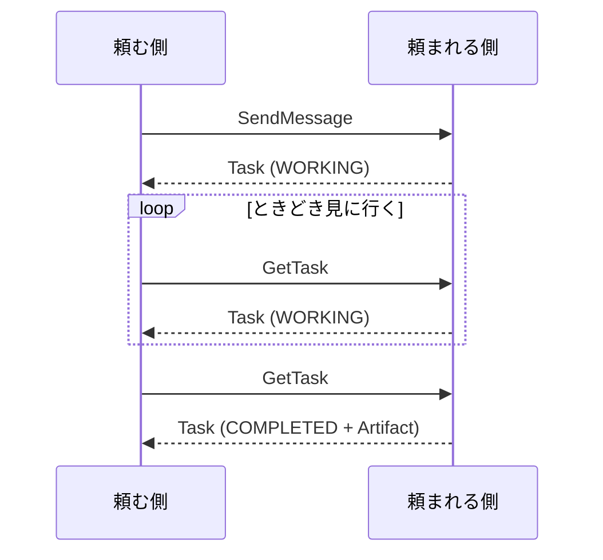
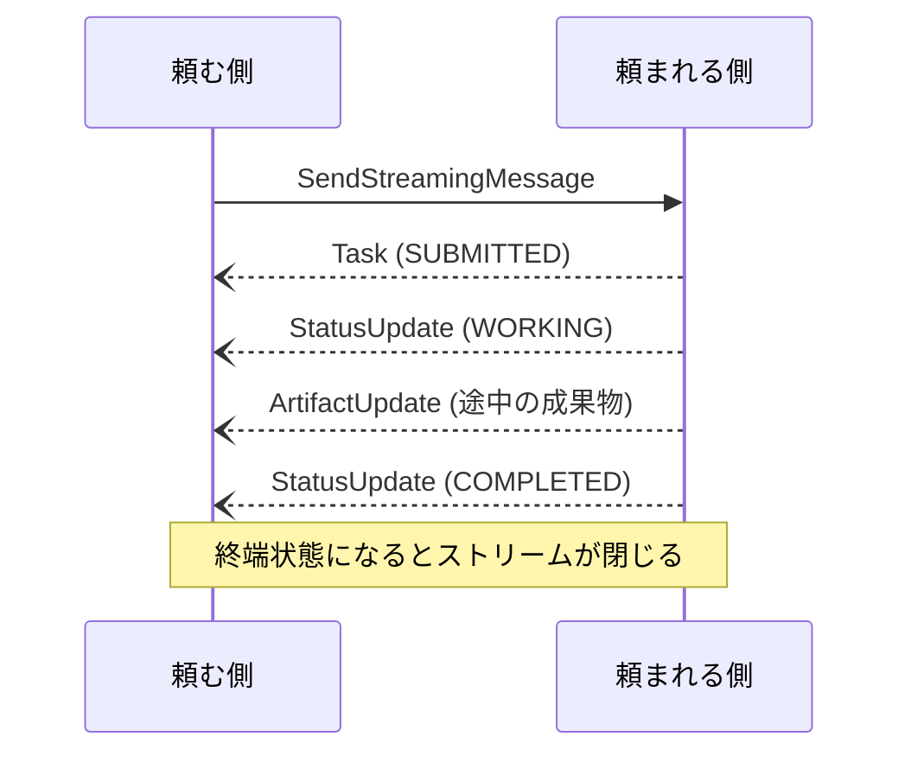
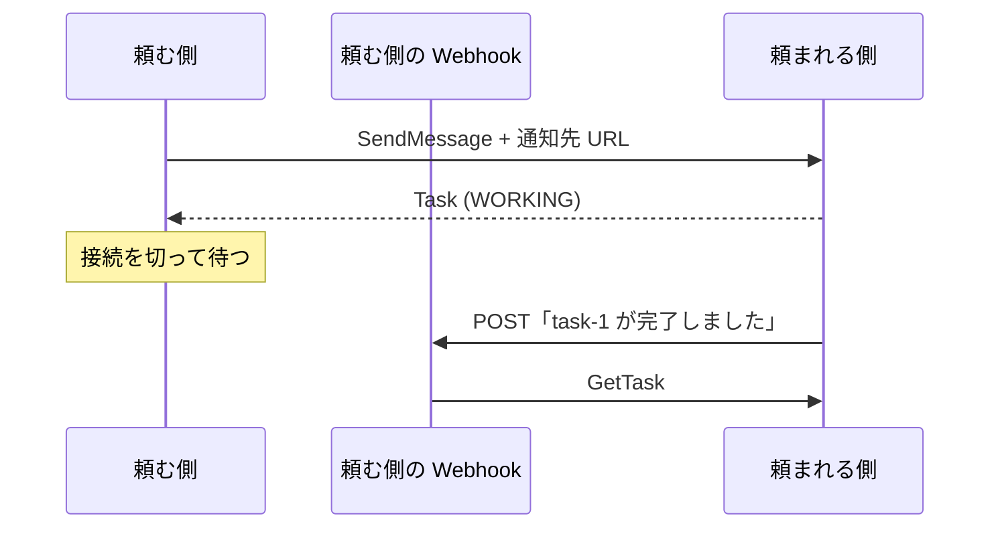
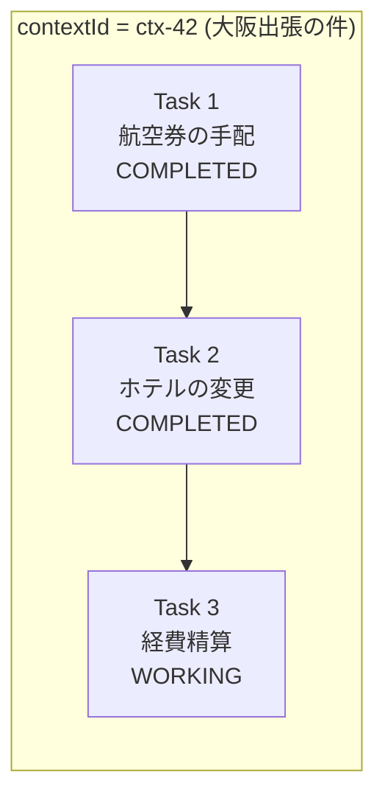

# タスクのライフサイクル

<p class="oneliner">A2A の中心は <b>Task (伝票)</b> です。伝票の状態がどう変わるかと、結果の受け取り方を押さえれば、A2A の動きはほぼ分かります。</p>

## 返事は「即答」か「伝票」か



## 伝票の状態



<div class="cards" markdown>
<div class="a2a" markdown>
**進行中**

`SUBMITTED` → `WORKING`
</div>
<div markdown style="border-top-color:#f59f00">
**あなた待ち** (中断)

`INPUT_REQUIRED` / `AUTH_REQUIRED`
</div>
<div markdown style="border-top-color:#2f9e44">
**終わり** (終端)

`COMPLETED` / `FAILED` / `CANCELED` / `REJECTED`
</div>
</div>

!!! warning "終わった伝票には、もう話しかけられない"
    終端状態のタスクにメッセージを送ると、エラー (`UnsupportedOperationError`) になります。続きを頼みたいときは、**同じ `contextId` で新しいタスク**を始めます。

## 質問されたら、同じ伝票番号で答える

「出張を手配して」→「日付は?」→「10 月 30 日」という往復は、次のように進みます。



コードにすると次のとおりです。まず相手側 (中身はブラックボックスという想定) です。

??? note "相手側のエージェント (クリックで開く)"
    ```python
    --8<-- "a2a/a2a_model.py:remote"
    ```

??? note "部品の定義 (クリックで開く)"
    ```python
    --8<-- "a2a/a2a_model.py:task"
    ```

**頼む側のコード**: 終わるまで状態を見て、質問されたら答えます。

```python
--8<-- "a2a/a2a_model.py:client"
```

??? success "実行結果"
    ```text
    相手からの質問: 日付はいつですか?
    TASK_STATE_COMPLETED → {'flight': 'NH21 08:00 HND→ITM', 'hotel': '梅田ホテル 1泊', 'date': '10月30日'}
    stream: Task
    stream: StatusUpdate
    stream: ArtifactUpdate
    stream: StatusUpdate
    ```

## 結果の受け取り方は 3 通り

| 受け取り方 | 向いている仕事 | 頼む側が用意するもの | 相手の名刺の条件 |
|---|---|---|---|
| ① ポーリング | 数秒〜数分で終わる | 特になし (`GetTask` を繰り返す) | なし |
| ② ストリーミング | 途中経過を画面に出したい | SSE を受け取れる接続 | `capabilities.streaming: true` |
| ③ プッシュ通知 | 何時間・何日もかかる | 通知を受ける Webhook の URL | `capabilities.pushNotifications: true` |

それぞれの流れは次のとおりです。

### ① 待つ / 見に行く (ポーリング)


**一番シンプル。** 数秒〜数分で終わる仕事向け。

### ② 流してもらう (ストリーミング)


**途中経過を画面に出したい**とき向け。名刺の `capabilities.streaming` が `true` の相手だけ使えます。HTTP の **SSE** (Server-Sent Events) で届きます。

### ③ 後で知らせてもらう (プッシュ通知)


**何時間・何日もかかる仕事**向け。名刺の `capabilities.pushNotifications` が `true` の相手だけ使えます。

## 会話のまとまり: contextId



`contextId` は相手が発行する「**案件番号**」です。同じ番号で続けて頼むと、相手は前のやり取りを踏まえて動けます。

!!! abstract "このページのまとめ"
    - 返事は **Message (即答)** か **Task (伝票)**。
    - 伝票は **進行中 → あなた待ち → 終わり** と状態が変わる。質問されたら**同じ `taskId`** で答える。
    - 結果は **ポーリング・ストリーミング・プッシュ通知** の 3 通りで受け取れる。

[次へ: A2A を使ってみる :material-arrow-right:](hands-on.md){ .md-button .md-button--primary }
