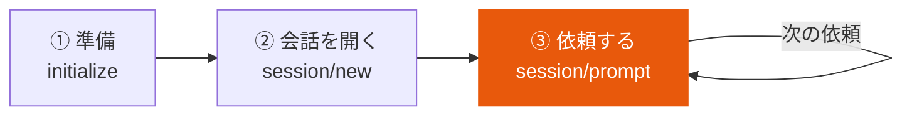
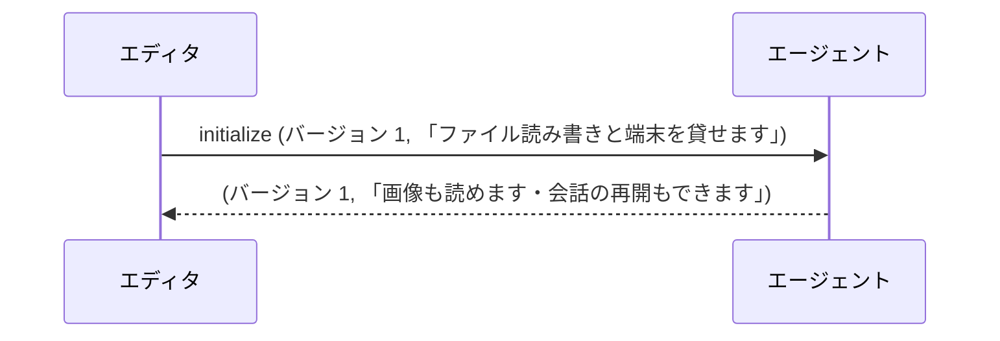
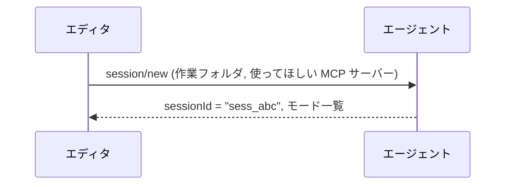
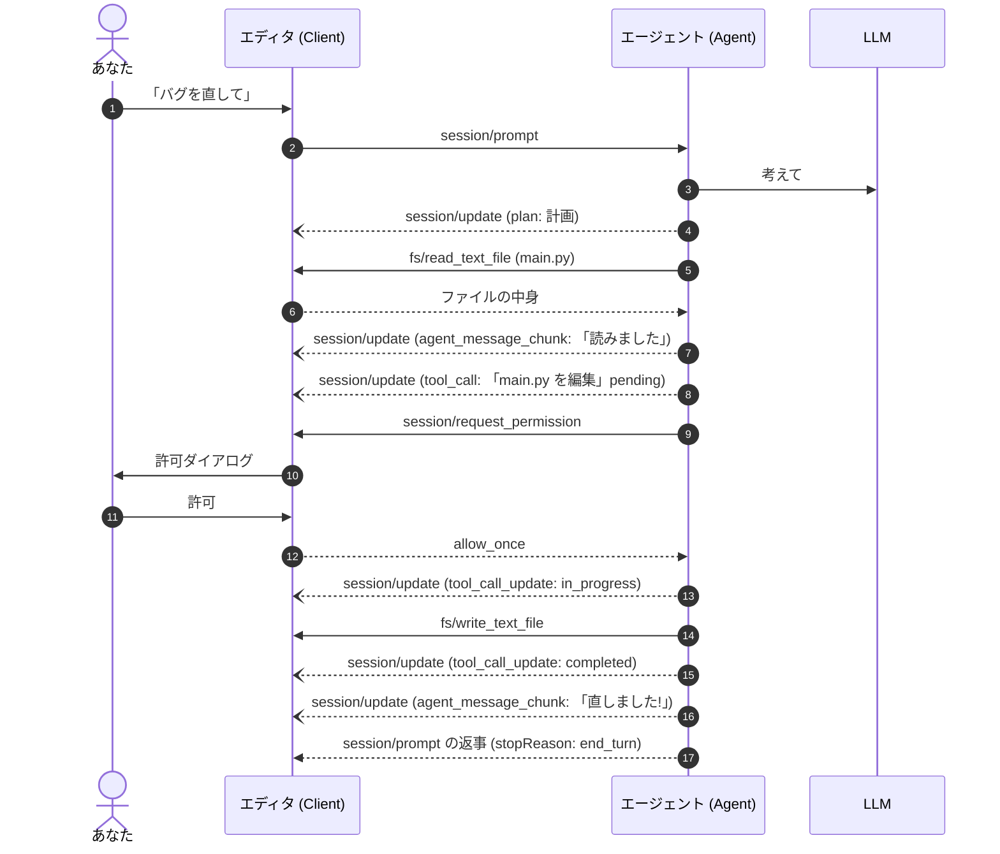
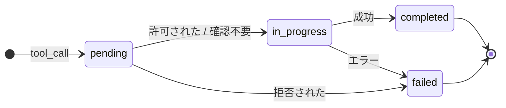
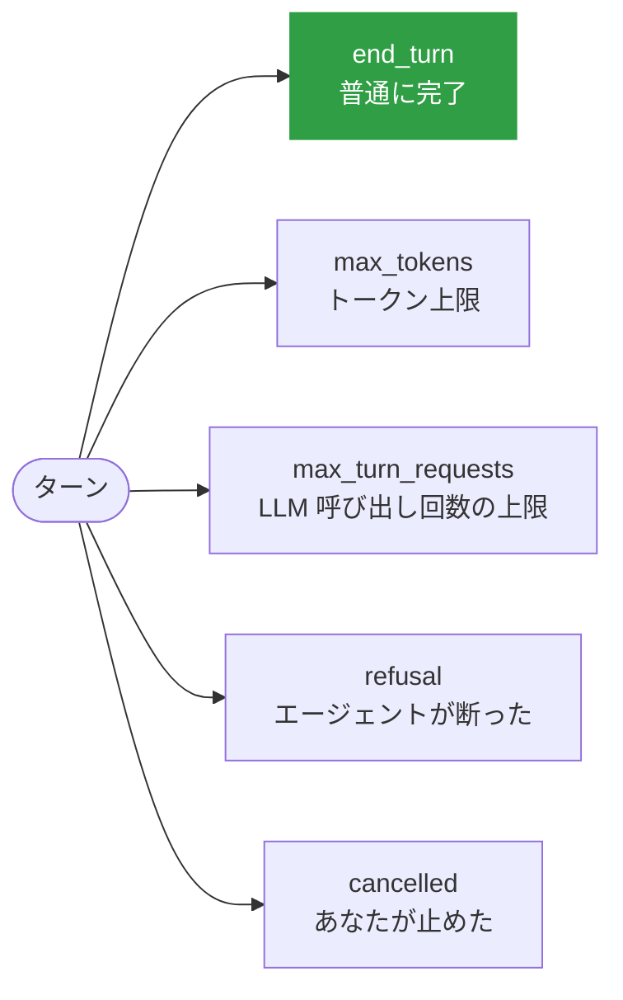

# 1 ターンの流れ

<p class="oneliner">「バグを直して」と頼んでから、エージェントが「直しました」と言うまでに、裏で何が起きているかを追いかけます。</p>

## 全体の 3 段階



### ① initialize: 自己紹介



お互いに**できること (capabilities)** を申告します。相手ができないことは頼みません。

### ② session/new: 会話を開く



1 つの接続で、**複数の会話 (セッション)** を同時に持てます。エディタに設定した MCP サーバーも、ここでエージェントに渡されます。

### ③ session/prompt: 依頼する (詳しい流れ)



!!! tip "見分け方"
    - **実線の矢印**は Request。返事を待ちます。
    - **点線で先が塗りつぶされた矢印**は、その Request への返事 (Response) です。
    - **点線で先が開いた矢印**は Notification。画面に流すだけで、返事はありません。
    - `session/prompt` の**返事はターンの最後**に来ます。途中経過は全部 `session/update` で届きます。

## 画面に届く「途中経過」の種類

`session/update` には種類があり、エディタはそれぞれを違う見た目で表示します。

| 種類 | 画面での見え方 | 例 |
|---|---|---|
| `agent_message_chunk` | 返答の文章が少しずつ出る | 「原因は…」 |
| `agent_thought_chunk` | 考えている内容 (折りたたみ) | 「まずテストを…」 |
| `plan` | チェックリスト | ☐ 読む ☐ 直す ☐ テスト |
| `tool_call` / `tool_call_update` | ツールの実行状況 | 📝 main.py を編集 … ✅ |
| `current_mode_update` | モード表示が変わる | ask → code |
| `usage_update` | 使ったトークン量・コスト | 12k / 200k |

ツール呼び出しは、次のように状態が移り変わります。



## ターンの終わり方 (stopReason)



途中で止めたいときは、エディタが `session/cancel` (Notification) を送ります。エージェントは作業を止めて、`cancelled` で返事をします。

## コードで動かしてみる

上の図の流れを、そのまま Python にしたものです。**部品 (語彙) → エージェント → エディタと実行**の順に読んでください。

??? note "部品: 途中経過の型 (クリックで開く)"
    ```python
    --8<-- "acp/acp_model.py:vocab"
    ```

    ```python
    --8<-- "acp/acp_model.py:updates"
    ```

**エージェント側** (LLM の代わりに決め打ちで動きます)

```python
--8<-- "acp/acp_model.py:agent"
```

**エディタ側と実行**

```python
--8<-- "acp/acp_model.py:editor"
```

??? success "実行結果"
    ```text
      UI <- Plan(entries=['main.py を読む', 'バグを直す'])
      UI <- AgentMessageChunk(text='11 文字読みました。')
      UI <- ToolCall(tool_call_id='call_1', title='main.py を編集', kind='edit', status='pending')
      ダイアログ: 「main.py を編集」を許可しますか? ['許可', '拒否']
      UI <- ToolCallUpdate(tool_call_id='call_1', status='in_progress')
      UI <- ToolCallUpdate(tool_call_id='call_1', status='completed')
      UI <- AgentMessageChunk(text='直しました!')
    stopReason: end_turn / main.py = print('hi')
    ```

!!! question "考えてみよう"
    `MiniEditor(auto_allow=False)` にすると、何が起きるでしょうか? `main.py` の中身はどうなりますか?

    ??? success "答え"
        `request_permission` が `"reject"` を返すので、エージェントはツール呼び出しを `failed` にして、ファイルを書き換えずにターンを終えます。`main.py` は `pritn('hi')` のままです。
        **人が拒否すれば、エージェントは何も変えられない**。これが ACP の安全の要です。

[次へ: ACP を使ってみる :material-arrow-right:](hands-on.md){ .md-button .md-button--primary }
