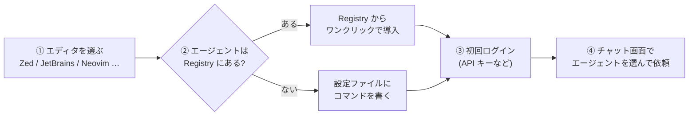
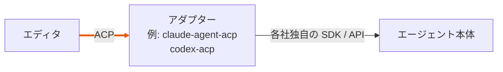
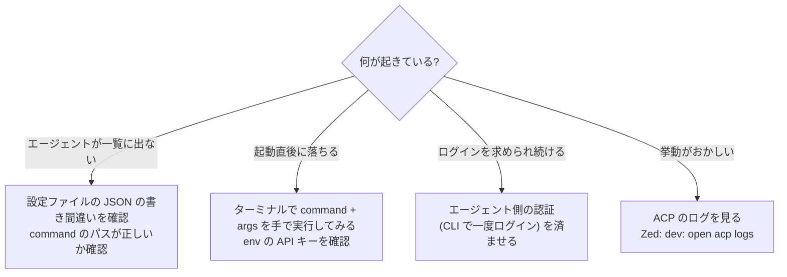

# ACP を使ってみる

<p class="oneliner">ユーザーとしてやることは、<b>「どのエディタで」「どのエージェントを」使うか決めて、登録するだけ</b>です。</p>

## 使い始めるまでの流れ



!!! info "ACP Registry とは"
    ACP 対応エージェントの**公式カタログ**です (2026 年 1 月開始)。登録されているエージェントは、対応エディタからまとめてインストールできます。
    Claude Code (Claude Agent)、Codex CLI、GitHub Copilot CLI、Gemini CLI、OpenCode などが載っています。

## エディタ別の手順

=== "Zed"

    **Registry から入れる**

    1. コマンドパレットで `zed: acp registry` を実行する (または `agent: open settings`)
    2. **External Agents** ページで `Add Agent` → `Install from Registry`
    3. エージェントパネルの「新しいスレッド」メニューに追加される

    **自分でコマンドを書く** (Registry に無いエージェント)

    ```json title="settings.json"
    {
      "agent_servers": {
        "my-agent": {
          "type": "custom",
          "command": "node",
          "args": ["~/projects/agent/index.js", "--acp"],
          "env": {}
        }
      }
    }
    ```

=== "JetBrains (IntelliJ / PyCharm など)"

    **Registry から入れる**

    1. AI Chat ツールウィンドウを開く
    2. チャットモードの切り替えから **Install From ACP Registry** を選ぶ (または Settings | Tools | AI Assistant | Agents)
    3. 入れたいエージェントをインストールして **OK**。必要な Node.js や Python の実行環境も自動で用意される

    **自分でコマンドを書く**

    AI Chat の `⋯` メニュー → **Add Custom Agent** で `~/.jetbrains/acp.json` が開きます。

    ```json title="~/.jetbrains/acp.json"
    {
      "default_mcp_settings": {},
      "agent_servers": {
        "Example Agent": {
          "command": "/path/to/agent",
          "args": ["acp"],
          "env": { "API_KEY": "your-api-key-here" }
        }
      }
    }
    ```

=== "その他"

    | 環境 | 方法 |
    |---|---|
    | Neovim | CodeCompanion、avante.nvim、agentic.nvim などのプラグイン |
    | Emacs | agent-shell.el |
    | VS Code | ACP Client などの拡張機能 |
    | Obsidian | Agent Client などのプラグイン |
    | ターミナル | acpx、Toad などの CLI / TUI クライアント |

    最新の一覧は公式サイトの [Clients](https://agentclientprotocol.com/get-started/clients) にあります。

!!! tip "設定の読み方: どのエディタでも同じ 3 点セット"
    ```mermaid
    flowchart LR
        cmd["command<br/>起動するプログラム"] --> proc(("エージェントの<br/>子プロセス"))
        args["args<br/>起動オプション (--acp など)"] --> proc
        env["env<br/>API キーなどの環境変数"] --> proc
    ```
    エディタは、ここに書かれたとおりに**エージェントを子プロセスとして起動する**だけです。ターミナルでそのコマンドを手で打って起動できるかを確かめると、問題の切り分けがしやすくなります。

## エージェントが ACP に対応していない場合

ACP に直接対応していないエージェントは、**アダプター** (翻訳役のプログラム) を挟んで使います。



Registry 経由で入れると、アダプターも一緒に用意されることがほとんどです。

## 上手に使うためのポイント

<div class="cards" markdown>
<div class="acp" markdown>
**許可の選び方**

最初は `allow_once` (今回だけ許可) を使い、信頼できた操作だけ `allow_always` にします。
</div>
<div class="acp" markdown>
**モードを切り替える**

`ask` (相談だけ) と `code` (編集してよい) のように、エージェントが提供するモードを使い分けます。
</div>
<div class="acp" markdown>
**MCP サーバーを渡す**

エディタに設定した MCP サーバーは、`session/new` のときにエージェントへ渡されます。
</div>
<div class="acp" markdown>
**会話を再開する**

`session/load` に対応したエージェントなら、エディタを閉じても会話の続きから始められます。
</div>
</div>

## 困ったときは



!!! example "ログを見ると勉強になる"
    Zed のコマンドパレットで `dev: open acp logs` を実行すると、エディタとエージェントの間を流れる **JSON-RPC の実物**が見られます。
    [1 ターンの流れ](flow.md) で見た `session/prompt` や `session/update` が、実際に流れているのを確認してみてください。

!!! abstract "この章のまとめ"
    - ACP は**エディタとエージェントを自由に組み合わせる**ための約束。
    - ユーザーは **Registry から入れる**か、**command / args / env を書く**だけ。
    - 危ない操作は**許可ダイアログ**で止められる。困ったら**ログを見る**。

[次へ: 第 3 章 A2A :material-arrow-right:](../a2a/index.md){ .md-button .md-button--primary }
