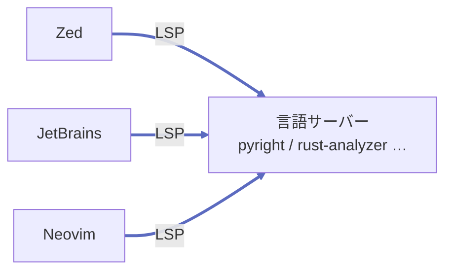
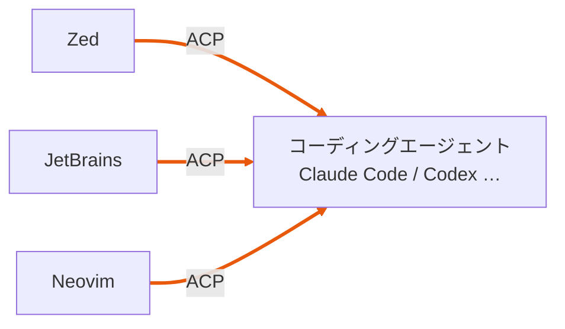
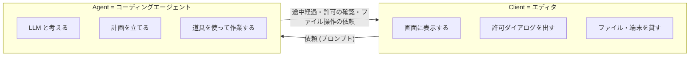
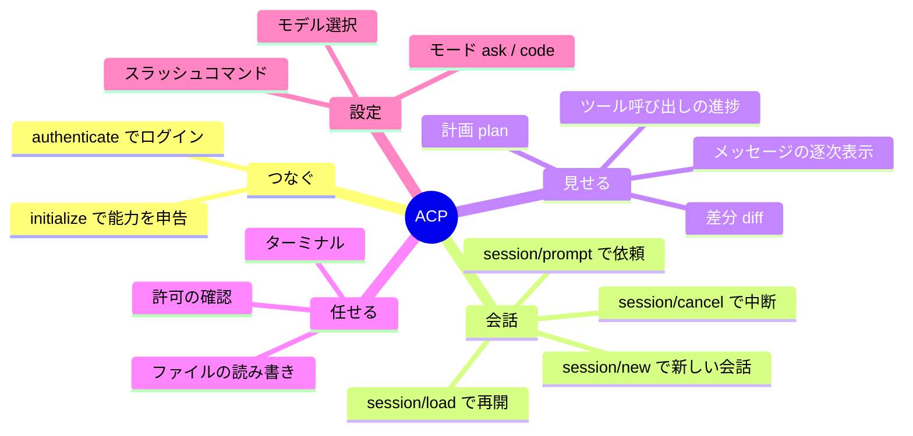
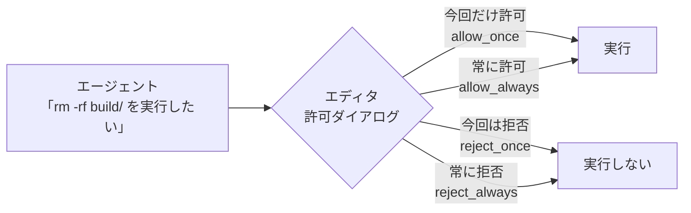

# ACP の概要

<p class="oneliner"><span class="badge acp">ACP</span> <b>Agent Client Protocol</b> は、<b>エディタ</b>と<b>コーディングエージェント</b>をつなぐ共通の約束です。「エージェント版の LSP」と考えると分かりやすいです。</p>

## LSP と並べると分かる

<div class="flip" markdown>

<div class="flip-item" data-label="LSP (おなじみ)" markdown>



どのエディタでも、同じ言語サーバーで**補完・エラー表示**が使えます。

</div>

<div class="flip-item" data-label="ACP" markdown>



どのエディタでも、同じエージェントに**コードを書かせられます**。

</div>

</div>

## 登場人物は 2 人だけ



!!! info "ポイント: エージェントは「エディタの子プロセス」"
    ローカルで使う場合、エディタが**エージェントのプログラムを起動**し、**標準入出力 (stdin / stdout)** で JSON-RPC をやり取りします。
    ポートを開けたり、サーバーを立てたりする必要はありません。

    ```mermaid
    flowchart LR
        E["エディタ (親プロセス)"] -- "起動 + stdin へ書く" --> A["エージェント (子プロセス)"]
        A -- "stdout へ書く" --> E
    ```

    リモートのエージェント (HTTP / WebSocket) への対応も進んでいますが、まだ整備中です。

## ACP が決めていること



## 窓口をコードで表すと

エディタとエージェントが、**お互いの窓口を呼び合う**関係になっています。

```python
--8<-- "acp/acp_model.py:protocols"
```

!!! tip "読み解きのポイント"
    - `Agent` の窓口は**エディタが呼ぶ**もの (依頼する、中断する)。
    - `Client` の窓口は**エージェントが呼ぶ**もの (見せる、許可を取る、ファイルを借りる)。
    - `read_text_file` がエディタ側にあるのがミソです。エージェントは**エディタで開いている未保存の内容**も読めます。

## ACP の「信頼」の考え方

ACP は「**自分が信頼して選んだエージェントを、自分のエディタで使う**」場面を想定しています。それでも、危ない操作の前には必ず人に確認できる仕組みがあります。



!!! abstract "このページのまとめ"
    - ACP = **エディタ ⇄ コーディングエージェント**の 1 対 1 の約束。
    - エージェントはエディタの**子プロセス**として動き、stdio で話す。
    - **双方向**: エージェントからもエディタに許可やファイル操作を頼む。

[次へ: 1 ターンの流れ :material-arrow-right:](flow.md){ .md-button .md-button--primary }
