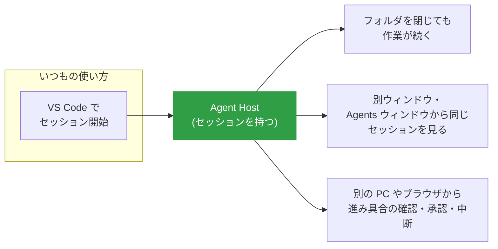
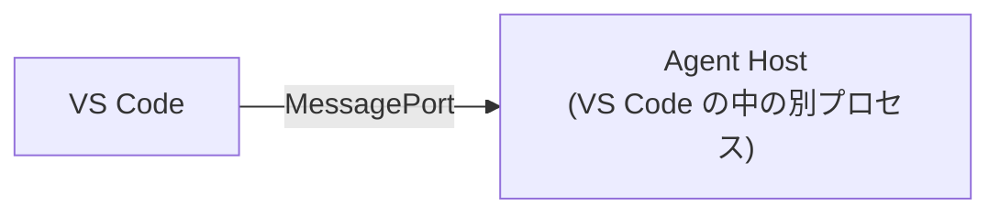
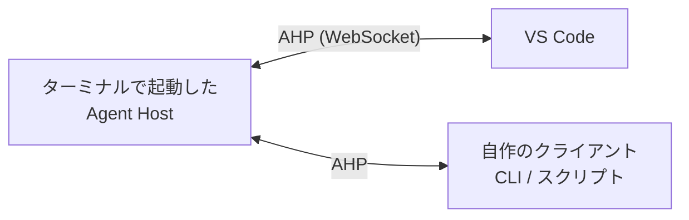
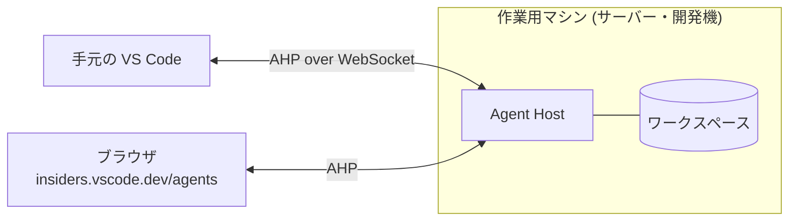
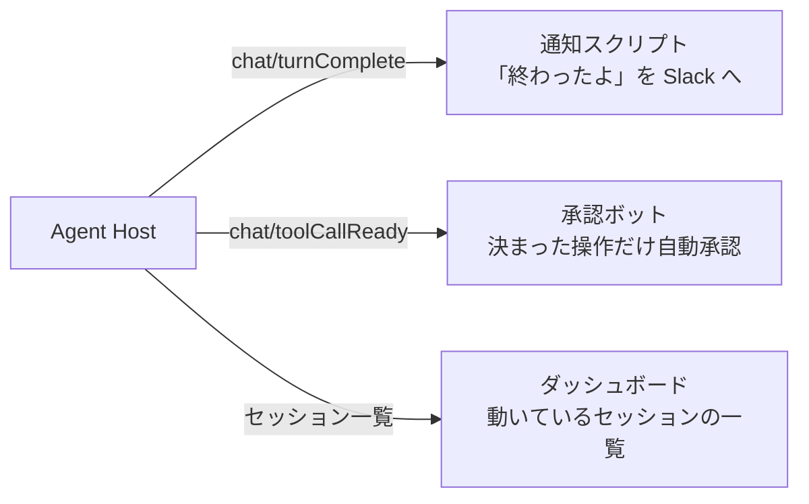

# AHP を使ってみる

<p class="oneliner">いちばん身近な AHP は <b>VS Code の Agent Host</b> です。普段は意識しなくても、裏で AHP が動いています。</p>

## VS Code の Agent Host でできること



Agent Host は、VS Code の最新の Stable 版と Insiders 版で有効になっています。中で動くエージェント (ハーネス) として、GitHub Copilot や Claude (Claude Agent SDK) などが用意されています。

## 使い方は 3 通り

| 使い方 | 始め方 | VS Code を閉じても続く? | 別の PC やブラウザから見る |
|---|---|---|---|
| ① ローカル | VS Code でセッションを始めるだけ | フォルダは閉じてよい。VS Code 本体は起動したまま | できない |
| ② 単独で起動 | `code agent host` を実行 | 続く | 同じマシンの VS Code や自作クライアントから |
| ③ 別のマシン | ワークスペースのあるマシンでホストを動かす | 続く | できる |

それぞれの構成は次のとおりです。

### ① ローカル (いちばん簡単)



1. フォルダを開き、ハーネスの選択で **Copilot** などを選んでセッションを始める
2. それだけで Agent Host 経由になります

!!! note
    ローカルのホストは VS Code が管理しているので、**VS Code 自体は起動したまま**にしておく必要があります (フォルダを閉じるのは大丈夫です)。

### ② 単独で起動する

```bash
code agent host            # Stable 版
code-insiders agent host   # Insiders 版
```



VS Code とは独立して動くので、**VS Code を閉じてもセッションが動き続けます**。自作のクライアントからつなぐこともできます。

### ③ 別のマシンで動かす



ホストを**ワークスペースのあるマシン**で動かし、手元の VS Code やブラウザからつなぎます。ファイルの編集はリモート側で行われます。
SSH・dev tunnels・Web からの接続手順は、VS Code の公式ドキュメントを参照してください。

## VS Code 以外の AHP 対応ツール

| 種類 | 名前 | できること |
|---|---|---|
| クライアント | **AHPX** | CLI / Node.js から、セッションの管理やプロンプトの送信 |
| クライアント | **ahpc** | ターミナルのチャット画面 (TUI) |
| ホスト | **AHP-ACP Gateway** | 設定した **ACP エージェント**を AHP ホストとして公開 (再接続・権限・キャンセル対応) |
| ホスト | **pi-ahp** / **hydra-ahp** | pi coding agent や Hydra のセッションを AHP で公開 |
| ライブラリ | 公式 SDK | Rust / TypeScript / Kotlin / Swift / Go / .NET |

!!! example "組み合わせの例: 好きな ACP エージェントを VS Code の Agents 画面で"
    ```mermaid
    flowchart LR
        V["VS Code<br/>Agents ウィンドウ"] -- "AHP" --> G["AHP-ACP Gateway"]
        B["ブラウザ"] -- "AHP" --> G
        G -- "ACP" --> A1["Gemini CLI"]
        G -- "ACP" --> A2["Goose"]
        linkStyle 0,1 stroke:#2f9e44,stroke-width:3px
        linkStyle 2,3 stroke:#e8590c,stroke-width:3px
    ```
    ゲートウェイがあれば、**ACP 対応のエージェントなら何でも**、AHP の「複数画面で共有」の恩恵を受けられます。

## 自分の仕組みとつなぐ: 何ができる?

公式 SDK を使えば、ホストに**自作のクライアント**をつなげられます。ユーザーとしてありがちな使い道は次のとおりです。



考え方は、[状態同期の仕組み](sync.md) の `ToyClient` と同じです。**チャンネルを購読し、届いたアクションに反応する**だけです。

!!! warning "自動承認は慎重に"
    `chat/toolCallConfirmed` を自動で送ると、**人の確認を飛ばしてエージェントに操作させる**ことになります。対象のツールや引数を絞り、ログを残しましょう。[安全に使う](../practice/safety.md) も読んでください。

!!! abstract "この章のまとめ"
    - VS Code の **Agent Host** が AHP の代表的なホスト。セッションが**画面から独立**する。
    - **ローカル・単独起動 (`code agent host`)・リモート**の 3 通りで使える。
    - **AHP-ACP Gateway** を使えば、ACP エージェントも複数画面で共有できる。

[次へ: 第 5 章 実践 :material-arrow-right:](../practice/choose.md){ .md-button .md-button--primary }
