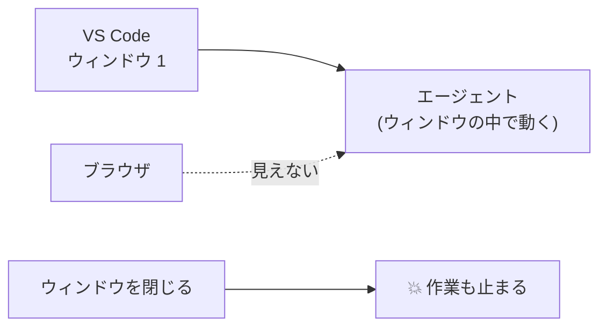
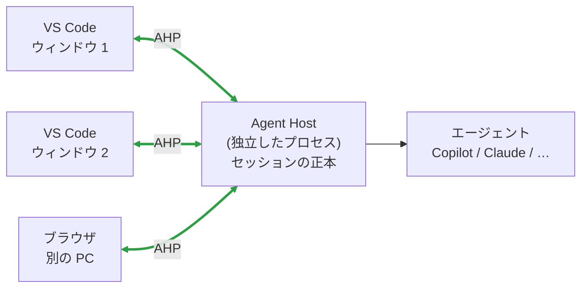
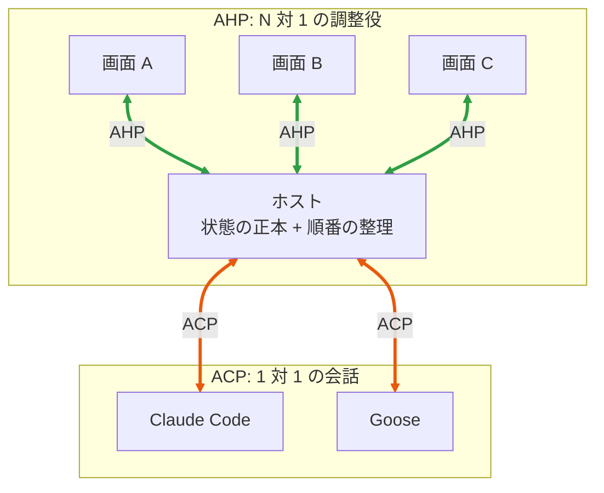
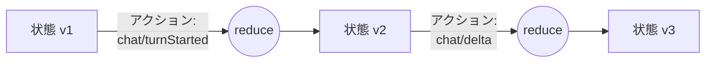
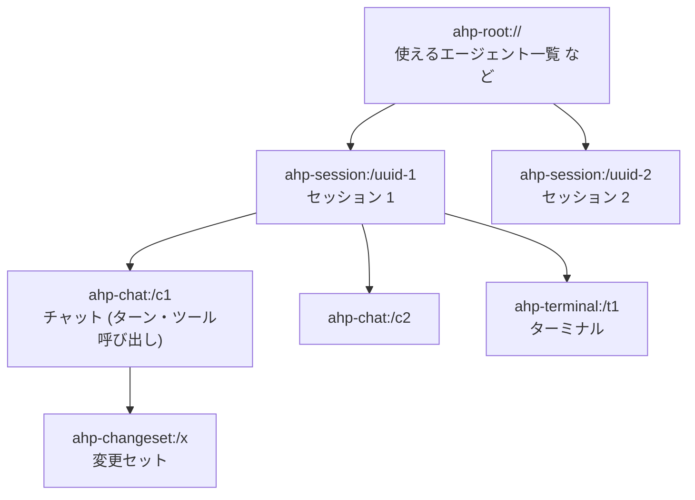

# AHP の概要

AHP <b>Agent Host Protocol</b> は、<b>1 つのエージェントセッションを、複数の画面や端末から同時に見て操作する</b>ための約束です。Microsoft が VS Code の Agent Host のために作り、公開しています。

## どんな困りごとを解決するのか

- セッションは**それを始めた画面の中**で動いている
- 別の画面からは見えない。画面を閉じると止まる

- セッションは**ホスト**が持っている。画面はそれを「見に行く」だけ
- 画面を閉じても作業は続く。別の画面から同じ作業を見て、承認や中断ができる

!!! example "身近な例: Google ドキュメントの共同編集"
    ドキュメントの本体はサーバーにあり、全員の画面に同じ内容が映ります。誰かが書き込むと、すぐに全員の画面に反映されます。
    AHP は、これを **AI エージェントのセッション**でやるための仕組みです。

## ACP との違い

ACP と AHP は似た位置にありますが、**解決する問題が違います**。

| | ACP | AHP |
|---|---|---|
| 数の関係 | 1 つの画面 ⇄ 1 つのエージェント | **たくさんの画面** ⇄ 1 つのホスト |
| 状態を持つのは | エージェント | **ホスト** (全員の画面はその写し) |
| 再接続 | 決めていない | 決めている (見逃した分を後から受け取る) |
| エージェントの詳細 | 見える | 見えない (どのエージェントでも同じ見た目) |

!!! tip "公式の例え: 「AHP は ACP にかけるミューテックス」"
    ACP は 1 対 1 の会話です。そこに複数の人が同時に割り込むと混乱します。
    AHP は、その会話の前に**受付係 (ホスト)** を置いて、「今は誰の番か」「承認は誰が先に押したか」を整理します。

## AHP の 4 つの考え方

**① チャンネル**

購読できる単位。URI で表す。`ahp-root://`、`ahp-session:/…`、`ahp-chat:/…`

**② 状態**

チャンネルごとの**変更できない (イミュータブル) データの木**

**③ アクション**

状態を変える**唯一の方法**。「ターン開始」「文字が届いた」など

**④ リデューサー**

`(状態, アクション) → 新しい状態` の**純粋関数**。ホストでも画面でも同じものを使う

!!! info "なぜこの形なの?"
    全員が**同じ初期状態**から**同じ順番で同じアクション**を**同じ関数**に通せば、必ず**同じ結果**になります。
    「画面ごとに表示がずれる」問題を、この仕組みで根本からなくしています。

## チャンネルの木

画面は**必要なチャンネルだけ**を購読します。一覧画面ならルートだけ、チャットを開いたらそのチャットも、という具合です。

!!! abstract "このページのまとめ"
    - AHP = **N 個の画面 ⇄ 1 つのホスト**の約束。セッションの**正本はホスト**にある。
    - ACP とは**競合せず、重ねて使う**。ホストの下で ACP を話すことができる。
    - 仕組みは **チャンネル・状態・アクション・リデューサー** の 4 つ。

[次へ: 状態同期の仕組み :material-arrow-right:](sync.md){ .md-button .md-button--primary }
