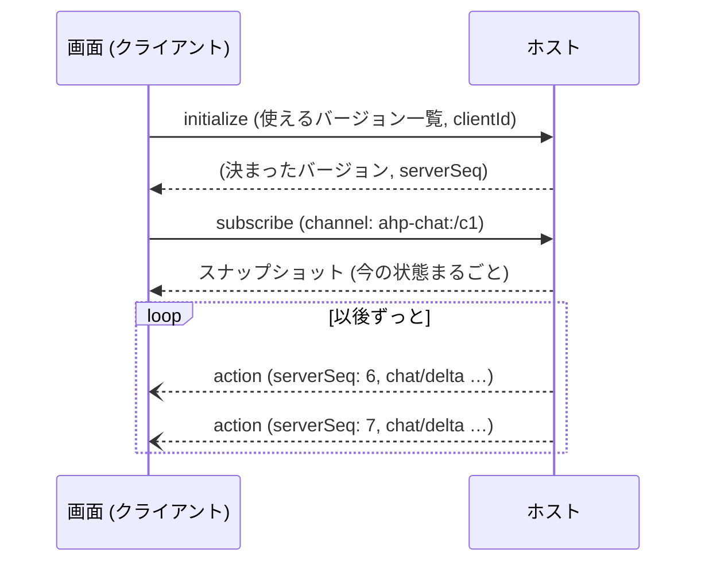
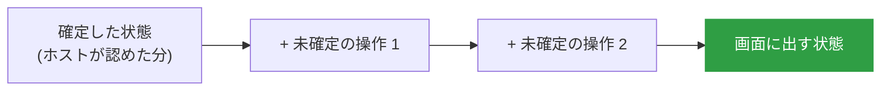
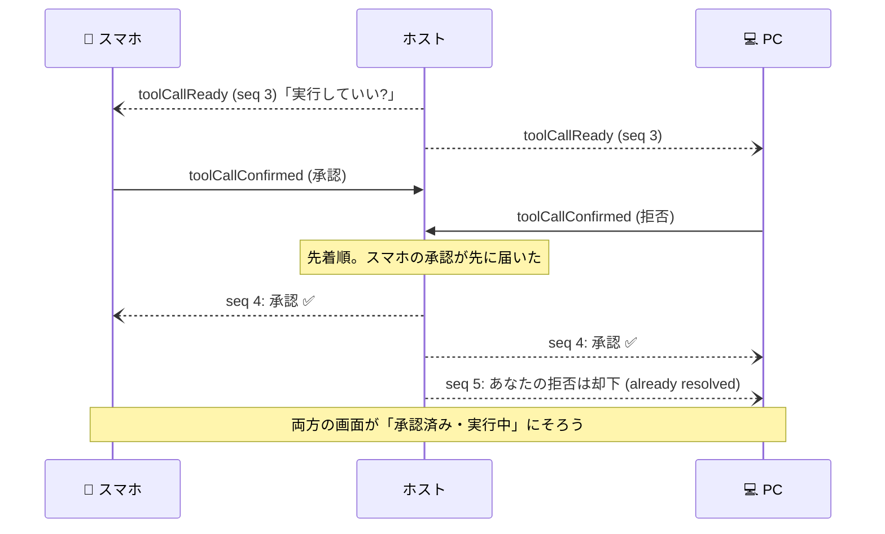
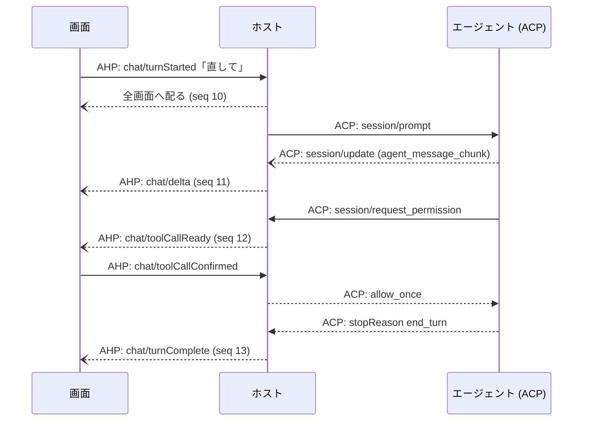

# 状態同期の仕組み

<p class="oneliner">複数の画面が同時に操作しても、最後は全員が同じ状態になる。その仕組みを、図とコードで追いかけます。</p>

## 基本の流れ: 購読 → スナップショット → アクション



- 最初に**今の状態をまるごと**もらう (スナップショット)
- その後は**差分 (アクション)** だけが、**通し番号 (`serverSeq`)** つきで届く
- 接続が切れても、「最後に見た番号」を伝えれば**見逃した分**を受け取れる

## 状態とアクションをコードで

```python
--8<-- "ahp/ahp_model.py:state"
```

リデューサーは、状態とアクションから新しい状態を作る**だけ**の関数です。

```python
--8<-- "ahp/ahp_model.py:reducer"
```

## 先に画面へ反映する: write-ahead

自分の操作を**ホストの返事を待たずに**画面に出し、あとで答え合わせします。これで操作がキビキビ感じられます。



ホストからアクションが届いたときの処理は、3 通りだけです。

| 届いたもの | 画面のやること |
|---|---|
| **自分の操作**が返ってきた | 未確定リストから外し、確定状態に入れる |
| **他人 (や AI) の操作** | 確定状態に入れる。未確定の操作はその上に積み直す |
| **却下された自分の操作** | 未確定リストから外す (画面から消える) |

## 同時に押したらどうなる?

ツールの実行確認に、スマホと PC から**ほぼ同時に**答えた場合です。



ホストと画面のコードは次のとおりです。

??? note "窓口の定義 (クリックで開く)"
    ```python
    --8<-- "ahp/ahp_model.py:protocols"
    ```

??? note "ホスト (クリックで開く)"
    ```python
    --8<-- "ahp/ahp_model.py:host"
    ```

**画面 (クライアント)**: `view` は「確定状態 + 自分の未確定の操作」です。

```python
--8<-- "ahp/ahp_model.py:client"
```

**動かしてみる**

```python
--8<-- "ahp/ahp_model.py:demo"
```

??? success "実行結果"
    ```text
    [laptop] 却下されました: already resolved
    ChatState(text='\n> テストを直して\n原因を調べます…', active_turn=None, tool='done')
    ```

    PC の遅れた「拒否」は却下され、最後の `assert` で **PC・スマホ・ホストの状態が完全に一致**していることを確かめています。

## ACP とつながるところ

ホストは、上 (画面) には AHP を、下 (エージェント) には ACP などを話す**通訳**です。



!!! abstract "このページのまとめ"
    - 最初に**スナップショット**、その後は**通し番号つきのアクション**が届く。
    - 自分の操作は**先に画面へ反映 (write-ahead)** し、ホストの返送で答え合わせする。
    - 承認のような取り合いは**ホストが先着順で決める**。全員が同じ状態にそろう。

[次へ: AHP を使ってみる :material-arrow-right:](hands-on.md){ .md-button .md-button--primary }
