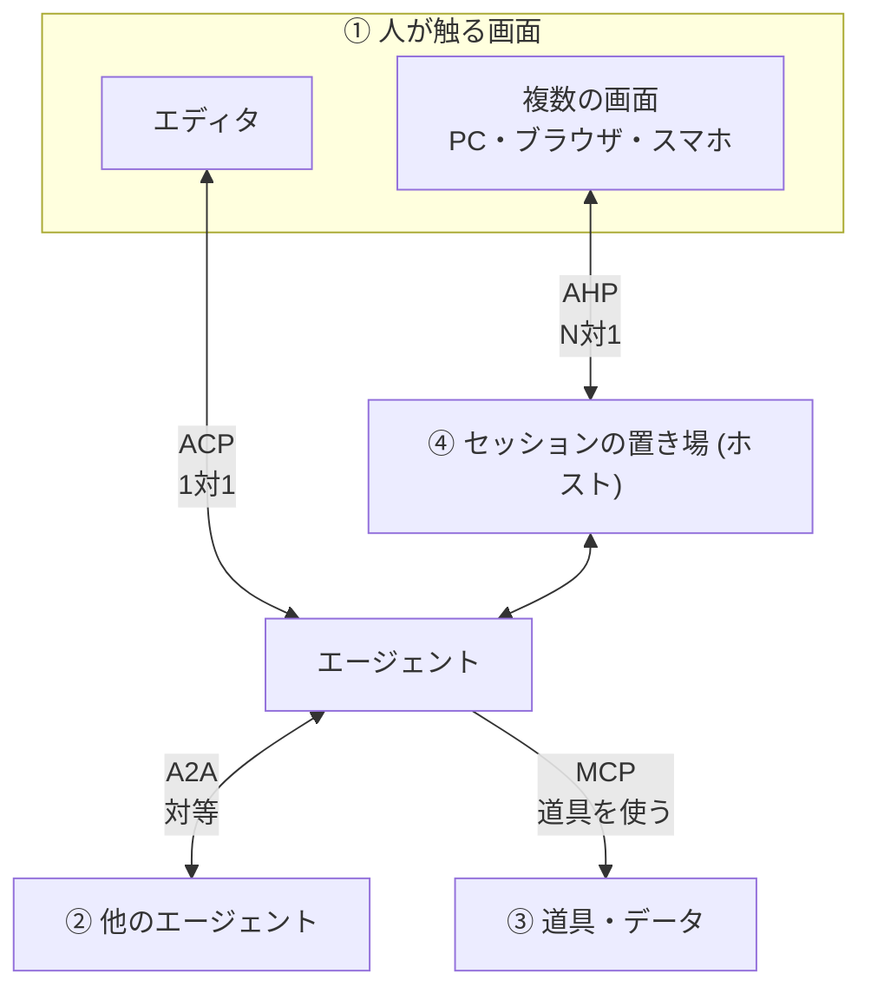
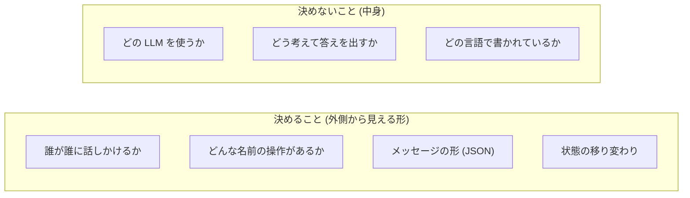

# なぜプロトコルが必要か

<p class="oneliner">プロトコルとは「お互いの中身を知らなくても話せるようにする、共通の約束事」です。</p>

## 約束が無い世界: N × M 問題

エディタが 3 つ、エージェントが 3 つあるとします。共通の約束が無いと、**組み合わせの数だけ専用のつなぎ込み**が必要になります。

=== "プロトコル無し: 3 × 3 = 9 本"

    ```mermaid
    flowchart LR
        Z[Zed] --- C1[Claude Code]
        Z --- C2[Gemini CLI]
        Z --- C3[Codex]
        J[JetBrains] --- C1
        J --- C2
        J --- C3
        N[Neovim] --- C1
        N --- C2
        N --- C3
    ```

    - エディタを 1 つ増やすたびに、全エージェント分の作業が必要になる
    - 「このエディタではこのエージェントしか使えない」という**囲い込み**が起きる

=== "プロトコル有り: 3 + 3 = 6 本"

    ```mermaid
    flowchart LR
        Z[Zed] --- P{{"共通の約束<br/>(ACP)"}}
        J[JetBrains] --- P
        N[Neovim] --- P
        P --- C1[Claude Code]
        P --- C2[Gemini CLI]
        P --- C3[Codex]
        style P fill:#e8590c,color:#fff,stroke:#e8590c
    ```

    - 各自は**約束に 1 回対応するだけ**でよい
    - 新しいエージェントが出ても、すぐにすべてのエディタで使える

!!! example "身近な例"
    - **USB**: どのメーカーのマウスでも、どのパソコンにも挿せる
    - **LSP** (Language Server Protocol): どのエディタでも、同じ言語サーバーで補完やエラー表示が使える
    - **HTTP**: どのブラウザでも、どのウェブサイトでも見られる

    エージェントの世界でも、これと同じことが起きています。

## エージェントの世界の「つなぎ目」は 4 か所

エージェントの周りには、性質の違うつなぎ目が 4 か所あります。それぞれに専用のプロトコルがあります。



| つなぎ目 | 困りごと | プロトコル |
|---|---|---|
| エディタ ⇄ エージェント | エディタごとにつなぎ込みが必要 | <span class="badge acp">ACP</span> |
| エージェント ⇄ エージェント | 他社のエージェントの呼び方がバラバラ | <span class="badge a2a">A2A</span> |
| 複数の画面 ⇄ セッション | PC で始めた作業をスマホで見られない | <span class="badge ahp">AHP</span> |
| エージェント ⇄ 道具 | ツールごとに接続方法が違う | <span class="badge mcp">MCP</span> |

!!! note "MCP について"
    MCP (Model Context Protocol) はこのサイトの主題ではありませんが、ほかの 3 つと一緒に登場することが多いので、比較のために出てきます。
    「エージェントに**道具**を持たせるもの」とだけ覚えておけば十分です。

## プロトコルが決めること・決めないこと



プロトコルは**窓口の形**だけを決めます。窓口の向こうで何が起きているかは自由です。
この考え方は、次のページの `typing.Protocol` で、そのままコードとして表せます。

[次へ: typing.Protocol で考える :material-arrow-right:](typing-protocol.md){ .md-button .md-button--primary }
