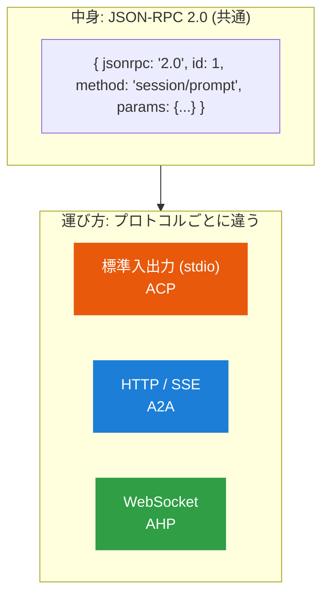
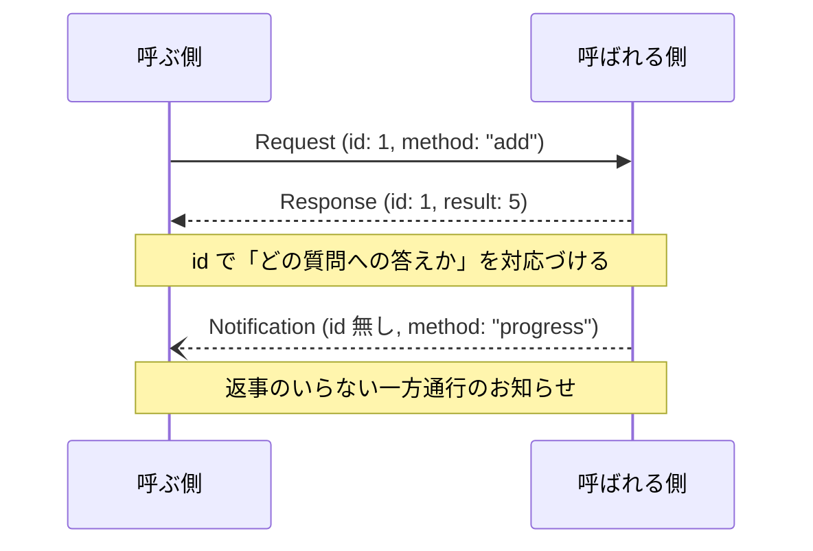
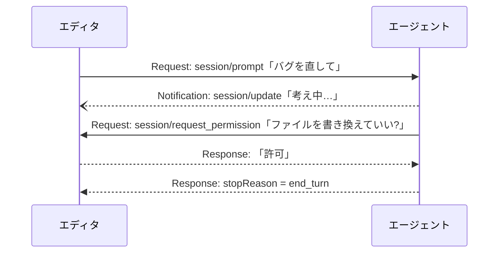

# 共通の土台 JSON-RPC

<p class="oneliner">A2A・ACP・AHP は、どれも <b>JSON-RPC 2.0</b> という同じ「話し方」を使っています。ここを押さえると、3 つとも読めるようになります。</p>

## 「中身」と「運び方」は別物



手紙に例えると、**JSON-RPC が便箋の書式**で、**stdio / HTTP / WebSocket が郵便・宅配便・バイク便**です。

## メッセージは 3 種類だけ



| 種類 | id | 返事 | 使いどころ |
|---|---|---|---|
| **Request** | あり | 必要 | 「これをして、結果を教えて」 |
| **Response** | Request と同じ | — | 結果 (`result`) か失敗 (`error`) |
| **Notification** | なし | 不要 | 途中経過の連絡、キャンセルなど |

!!! tip "これだけ覚えると仕様が読める"
    各プロトコルの仕様書は、ほぼ「**どんな `method` があり、`params` に何を入れ、何が返るか**」の一覧です。
    - ACP: `session/prompt` (Request)、`session/update` (Notification)
    - A2A: `SendMessage` (Request)
    - AHP: `subscribe` (Request)、`dispatchAction` (Notification)

## コードで見る

**メッセージの形** (`TypedDict` で JSON の形を表しています)

```python
--8<-- "basics/jsonrpc.py:messages"
```

**運び方は Protocol で差し替えられる**

```python
--8<-- "basics/jsonrpc.py:transport"
```

**試しに足し算サーバーを呼んでみる**

```python
--8<-- "basics/jsonrpc.py:loopback"
```

`call()` は `Transport` という**形**しか知りません。`LoopbackTransport` を、stdio や WebSocket の実装に入れ替えても、そのまま動きます。

## 双方向という大事な性質

JSON-RPC では、**どちらの側からも** Request を送れます。これが特に ACP と AHP で効いてきます。



普通の Web API は「クライアントが聞いてサーバーが答える」一方向です。エージェントのプロトコルでは、**エージェントの側から人間に確認を求める**ことがよくあるので、双方向が重要になります。

[次へ: 全体地図 :material-arrow-right:](map.md){ .md-button .md-button--primary }
