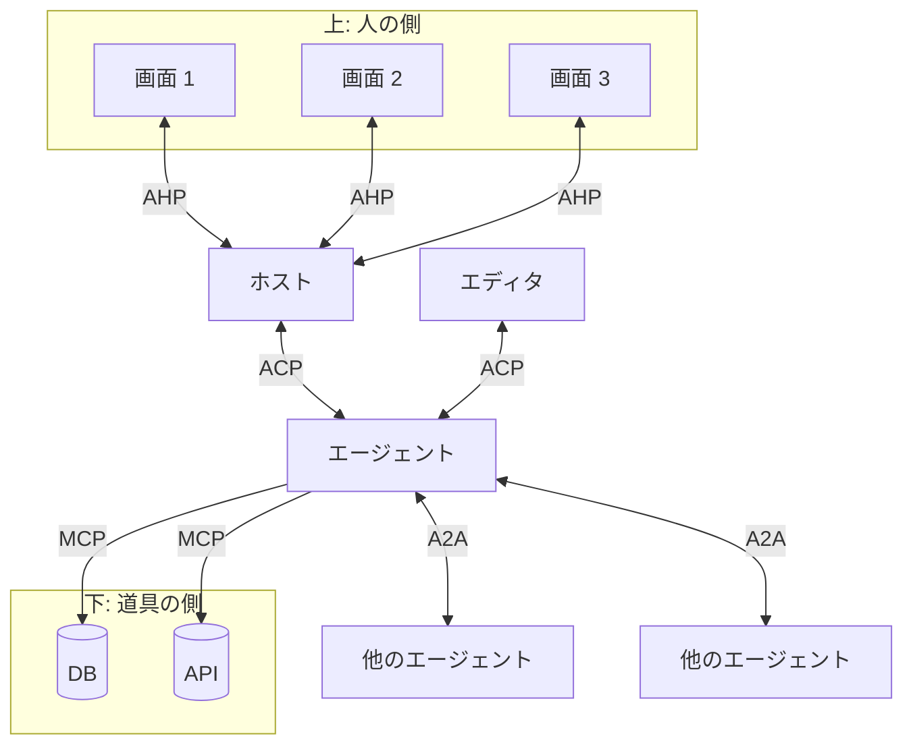
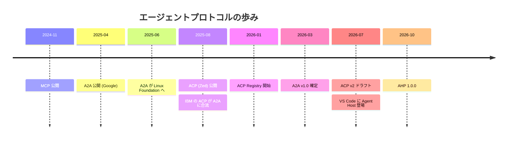
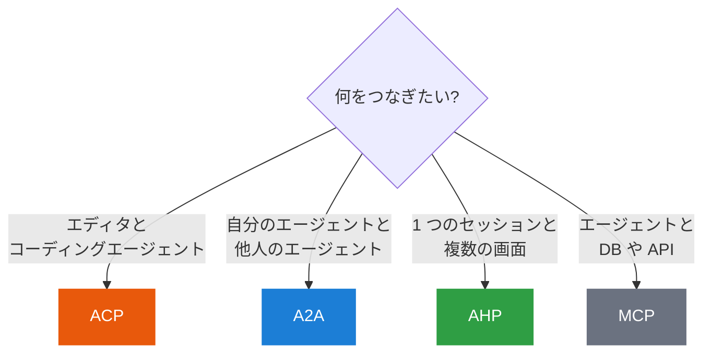

# 全体地図

4 つのプロトコルは競合関係ではありません。担当する「つなぎ目」が違うので、<b>組み合わせて使う</b>ものです。

## 向きで覚える

- **縦 (上)**: 人が触る画面とエージェントをつなぐ → ACP AHP
- **横**: エージェント同士をつなぐ → A2A
- **縦 (下)**: エージェントに道具を持たせる → MCP

## 4 つを並べて比べる

| | ACP | A2A | AHP | MCP |
|---|---|---|---|---|
| 正式名 | Agent Client Protocol | Agent2Agent Protocol | Agent Host Protocol | Model Context Protocol |
| つなぐもの | エディタ ⇄ エージェント | エージェント ⇄ エージェント | 複数のクライアント ⇄ ホスト | エージェント ⇄ 道具 |
| 数の関係 | 1 対 1 | 対等 (多対多) | N 対 1 | 1 対 多 |
| 相手の中身 | 信頼して任せる | **見えない (opaque)** | ホストが代表する | 道具として見える |
| 主な運び方 | stdio (ローカル) | HTTP(S) / SSE / gRPC | WebSocket / MessagePort | stdio / HTTP |
| 中心になる概念 | セッションとターン | **タスク**と成果物 | **状態**とアクション | ツールとリソース |
| 主な推進者 | Zed, JetBrains ほか | Linux Foundation (旧 Google) | Microsoft (VS Code) | Anthropic → Linux Foundation |
| 似ているもの | LSP | 外注・業務委託 | Google ドキュメントの共同編集 | USB ポート |

## 時系列で見る

!!! danger "名前の衝突に注意: 「ACP」は 2 つある"
    | | Agent **Client** Protocol | Agent **Communication** Protocol |
    |---|---|---|
    | 作ったところ | Zed など | IBM (BeeAI) |
    | 目的 | エディタ ⇄ エージェント | エージェント ⇄ エージェント |
    | 現在 | **活発に開発中** (このサイトの ACP) | 2025 年 8 月に **A2A へ合流**して開発終了 |

    2025 年前半の記事で「ACP」とあれば、IBM の方を指していることが多いです。
    このサイトの「ACP」は、すべて **Agent Client Protocol** を指します。

## 判断に迷ったら

詳しい選び方は [第 5 章 選び方](../practice/choose.md) で扱います。まずは身近な ACP から見ていきましょう。

[次へ: 第 2 章 ACP :material-arrow-right:](../acp/index.md){ .md-button .md-button--primary }
