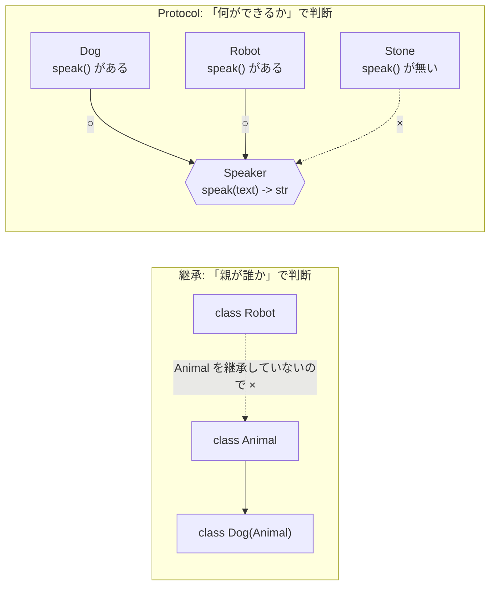
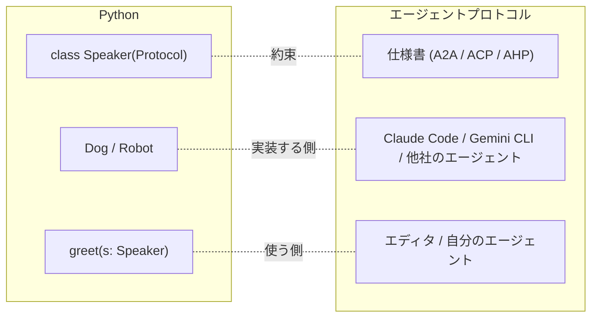

# typing.Protocol で考える

<p class="oneliner">「形が合っていれば、相手が何者でも使える」。これがプロトコルの考え方であり、Python の <code>typing.Protocol</code> の考え方でもあります。</p>

## 継承 (名前で判断) と Protocol (形で判断)



## コードで確認

**1. 約束 (窓口の形) を書く**

```python
--8<-- "basics/protocol_intro.py:protocol"
```

**2. 約束を知らない人たちが実装する** (継承していません)

```python
--8<-- "basics/protocol_intro.py:impls"
```

**3. 使う側は約束だけを見る**

```python
--8<-- "basics/protocol_intro.py:use"
```

## エージェントプロトコルに置き換えると



| Python | エージェントプロトコル |
|---|---|
| `Protocol` クラスのメソッド | 仕様書で決められた操作 (`session/prompt`, `SendMessage` など) |
| 引数・戻り値の型 | JSON メッセージの形 |
| 実装クラス | 各社のエージェントやエディタ |
| mypy の型チェック | 仕様への準拠 (互換性) |

!!! tip "このサイトのコードの読み方"
    各章には、次のようなコードが出てきます。

    ```python
    class Agent(Protocol):
        def prompt(self, session_id: str, text: str) -> StopReason: ...
    ```

    これは「**エージェントには `prompt` という窓口があり、セッション ID と文章を渡すと、止まった理由が返ってくる**」と読みます。
    本物は JSON-RPC のメッセージとして送られますが、意味は同じです。メソッド名の横のコメント (`# session/prompt` など) が、本物の操作名です。

!!! abstract "このページのまとめ"
    - プロトコル = **窓口の形**の約束。中身は問わない。
    - `typing.Protocol` = 継承ではなく**形**で判断する型。
    - この 2 つは同じ考え方なので、以降はコードで窓口を説明します。

[次へ: 共通の土台 JSON-RPC :material-arrow-right:](jsonrpc.md){ .md-button .md-button--primary }
