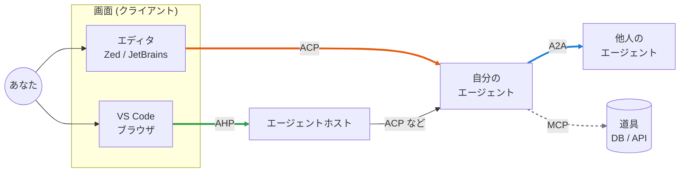
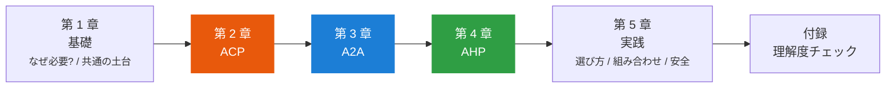

# エージェントプロトコル入門

AI エージェント同士、エージェントとエディタ、エージェントと画面をつなぐ「共通の約束」を、図とコードで学ぶサイトです。

## このサイトで分かるようになること

ACP **Agent Client Protocol**

好きな**エディタ**から、好きな**コーディングエージェント**を使う

A2A **Agent2Agent Protocol**

自分のエージェントから、**他人のエージェント**に仕事を頼む

AHP **Agent Host Protocol**

1 つのセッションを、**複数の画面や端末**から同時に見て操作する

## 1 枚で見る全体像

!!! tip "まずはここだけ覚えれば OK"
    | プロトコル | つなぐもの | 関係 | ひとことで |
    |---|---|---|---|
    | ACP | エディタ ⇄ エージェント | 1 対 1 | エージェント版の LSP |
    | A2A | エージェント ⇄ エージェント | 対等 | 他社の同僚に頼む窓口 |
    | AHP | 複数の画面 ⇄ ホスト | N 対 1 | セッションの共有ノート |
    | MCP (参考) | エージェント ⇄ 道具 | 1 対 多 | 道具箱の差込口 |

## 学習ロードマップ

各章は同じ並びになっています。

1. **概要**: 何のためのものか、誰と誰をつなぐか
2. **仕組み**: シーケンス図と `typing.Protocol` のコードで、やり取りを追う
3. **使ってみる**: ユーザーとして使い始める手順と、つまずきやすい点

## このサイトの読み方

!!! info "対象読者とゴール"
    - **前提知識**: Python を少し読める。JSON を見たことがある。プロトコルの知識はゼロで OK。
    - **ゴール**: 各プロトコルの役割と動きを説明でき、**自分のやりたいことに合うものを選んで使い始められる**こと。
    - **扱わないこと**: プロトコルそのものの実装者や SDK 開発者になるための詳細 (全メソッドの仕様、ワイヤーフォーマットの細部など) は扱いません。

??? question "なぜ Python の `typing.Protocol` で説明するの?"
    プロトコルの本質は「**相手が何者かは知らなくていい。この形の窓口さえあれば話せる**」という約束です。
    これは Python の `typing.Protocol` (構造的部分型) の考え方とまったく同じです。
    窓口の形をコードにすると、長い説明文よりも正確に、短く伝えられます。詳しくは [typing.Protocol で考える](basics/typing-protocol.md) で説明します。

    サイト内のコードはすべて実際に動き、`mypy --strict` の型チェックも通ることを確認しています。

!!! warning "情報の時点"
    内容は **2026 年 10 月時点** の公式資料に基づいています。

    - A2A **v1.0** (2026 年 3 月に確定)
    - ACP **v1** (安定版。v2 は 2026 年 7 月にドラフト公開)
    - AHP **1.0.0** (2026 年 10 月 2 日リリース)

    どれも動きの速い分野です。実際に使う前に [参考リンク](appendix/links.md) の公式ドキュメントも確認してください。
