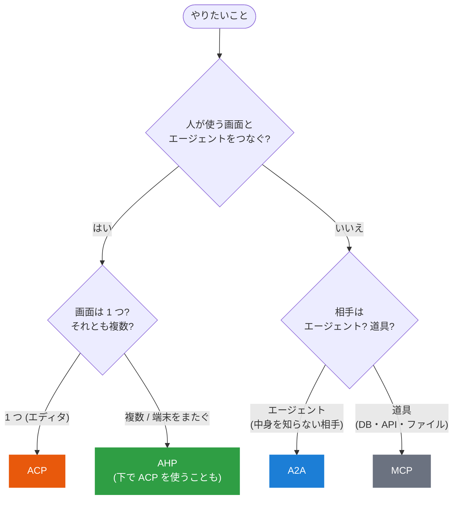

# 選び方

<p class="oneliner">「何と何をつなぎたいか」が決まれば、使うプロトコルは自然に決まります。</p>

## 判断フローチャート



## 判断をコードにすると

```python
--8<-- "practice/choose.py:choose"
```

当てはまるものが複数あれば、**全部使います**。プロトコル同士は競合しません。

## 迷いやすいところ

??? question "A2A と MCP、どっちで呼べばいい? (相手がエージェントかツールか微妙なとき)"
    ```mermaid
    flowchart LR
        X{"相手は…"} -->|"決まった入力に決まった出力<br/>(関数のように振る舞う)"| MCP["MCP<br/>道具として呼ぶ"]
        X -->|"自分で判断し、質問し返し、<br/>時間をかけて仕事をする"| A2A["A2A<br/>同僚に頼む"]
        style MCP fill:#6b7280,color:#fff,stroke:#6b7280
        style A2A fill:#1c7ed6,color:#fff,stroke:#1c7ed6
    ```
    - 「天気 API」「SQL を実行」→ **MCP** (道具)
    - 「出張を手配して (日程の相談あり)」「この契約書をレビューして」→ **A2A** (同僚)

    目安は、**途中で質問し返してくるか** (`INPUT_REQUIRED`)、**長時間かかるか** (Task の追跡が必要か) です。

??? question "ACP と AHP、どっちを使えばいい?"
    | 状況 | 選ぶもの |
    |---|---|
    | 自分のエディタで、好きなエージェントを使いたい | **ACP** |
    | PC で始めた作業を、ブラウザや別の PC でも見たい | **AHP** |
    | 画面を閉じても、エージェントに作業を続けてほしい | **AHP** |
    | チームで 1 つのセッションを見守りたい | **AHP** |

    AHP のホストは、裏で ACP を使ってエージェントと話せます。「**AHP の下に ACP**」は、よくある組み合わせです。

??? question "ACP でエージェント同士を連携させてもいい?"
    おすすめしません。ACP は**画面とエージェントの 1 対 1**のために設計されていて、エージェントを「対等な相手」として扱う仕組み (名刺による発見、タスクの追跡、認証方式の宣言など) がありません。
    エージェント同士なら **A2A** を使いましょう。

## 1 枚にまとめると

| やりたいこと | プロトコル |
|---|---|
| エディタで好きなエージェントを使う | <span class="badge acp">ACP</span> |
| 他チーム・他社のエージェントに仕事を頼む | <span class="badge a2a">A2A</span> |
| 1 つのセッションを複数の画面で共有する | <span class="badge ahp">AHP</span> |
| エージェントに DB・API などの道具を持たせる | <span class="badge mcp">MCP</span> |

[次へ: ユースケース集 :material-arrow-right:](usecases.md){ .md-button .md-button--primary }
