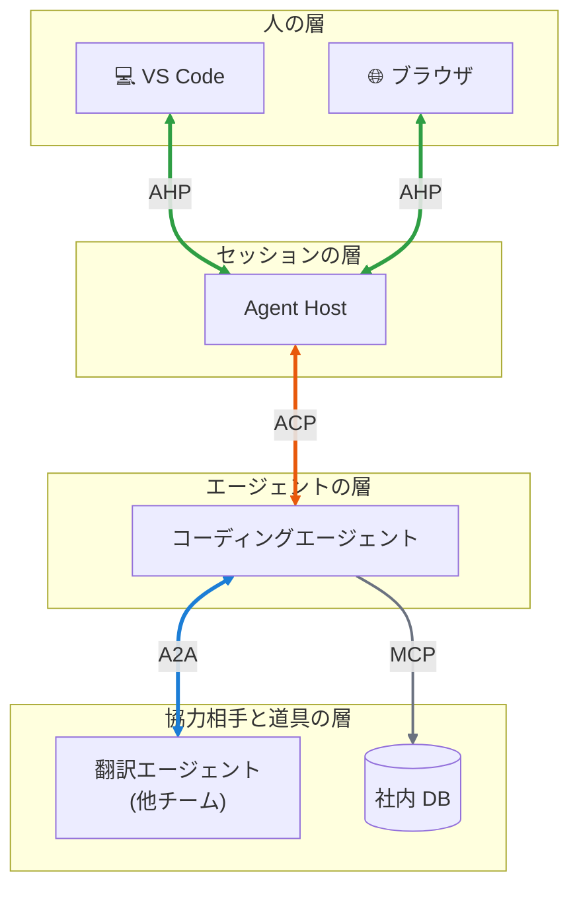
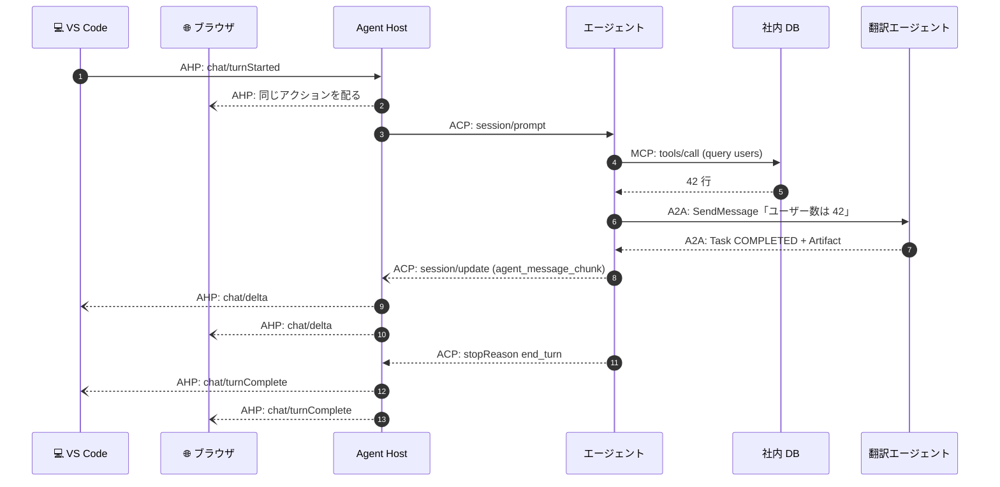

# 組み合わせる

<p class="oneliner">4 つのプロトコルは、それぞれ違う「つなぎ目」を担当しています。重ねると、1 つの依頼が層を順番に降りていきます。</p>

## 全部入りの構成図



## 1 つの依頼を追いかける

「ユーザー数を英語でレポートして」と頼んだときの流れです。



## コードで重ねてみる

各層を `Protocol` で表すと、**それぞれが下の層の形しか知らない**ことが分かります。

```python
--8<-- "practice/compose.py:layers"
```

```python
--8<-- "practice/compose.py:impl"
```

??? success "実行結果"
    ```text
    laptop <- [英訳] users の行数は 42  (依頼者: laptop)
    browser <- [英訳] users の行数は 42  (依頼者: laptop)
    ```

!!! tip "層が分かれていると嬉しいこと"
    ```mermaid
    flowchart LR
        x1["エディタを変える"] --> y1["ACP / AHP の上だけ変わる"]
        x2["エージェントを変える"] --> y2["ACP の下だけ変わる"]
        x3["翻訳の外注先を変える"] --> y3["A2A の相手だけ変わる"]
        x4["DB を変える"] --> y4["MCP サーバーだけ変わる"]
    ```
    どこか 1 か所を入れ替えても、**ほかの層には影響しません**。これがプロトコルを使う一番の価値です。

## よくある組み合わせパターン

| パターン | 構成 | 向いている場面 |
|---|---|---|
| **エディタ派** | エディタ —ACP→ エージェント —MCP→ 道具 | 個人の開発作業 |
| **常駐派** | 画面たち —AHP→ ホスト —ACP→ エージェント | 長時間の作業、端末をまたぐ作業 |
| **分業派** | 窓口エージェント —A2A→ 専門エージェントたち | 社内の業務自動化 |
| **全部入り** | 上の図のとおり | チームでの開発と、外部への外注の組み合わせ |

[次へ: 安全に使う :material-arrow-right:](safety.md){ .md-button .md-button--primary }
