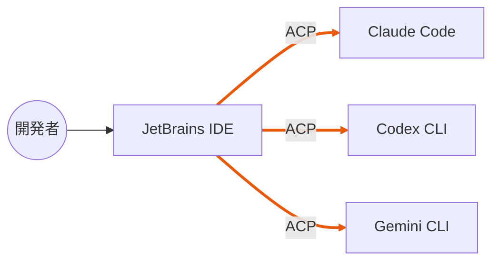
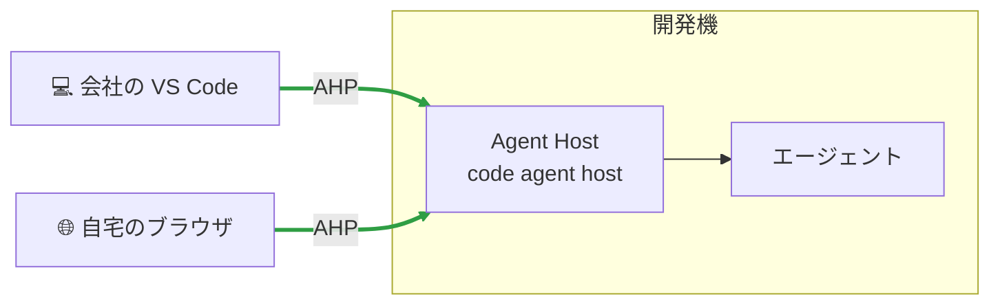
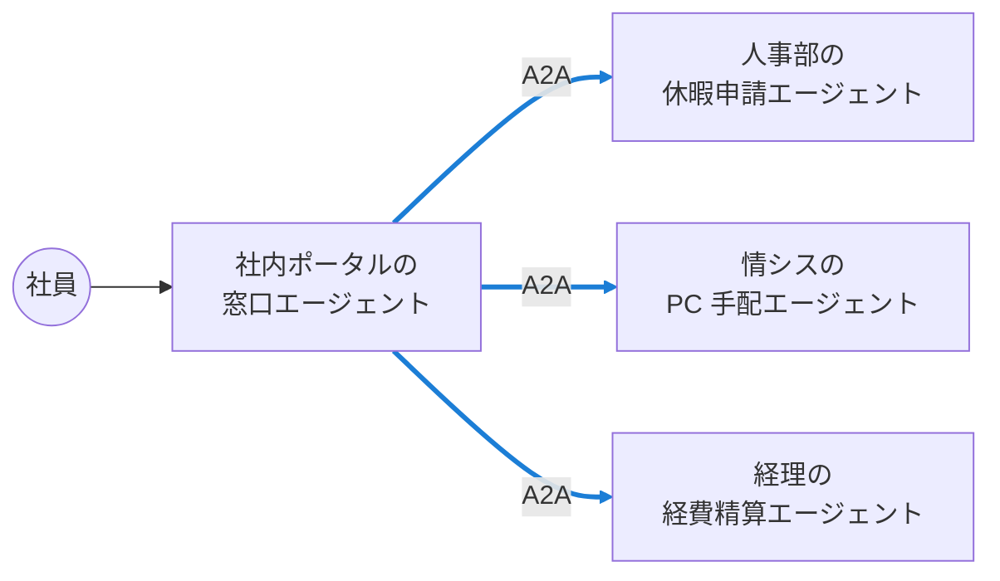
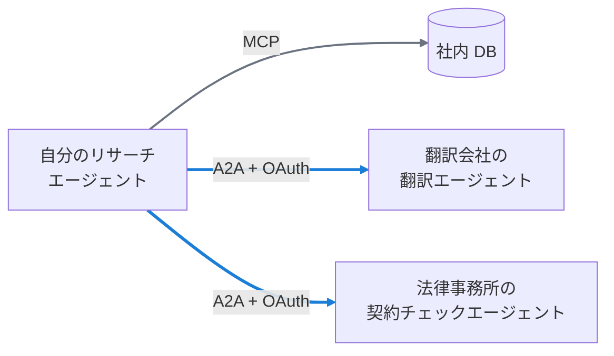
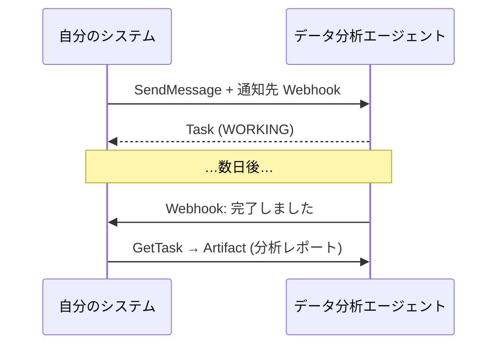
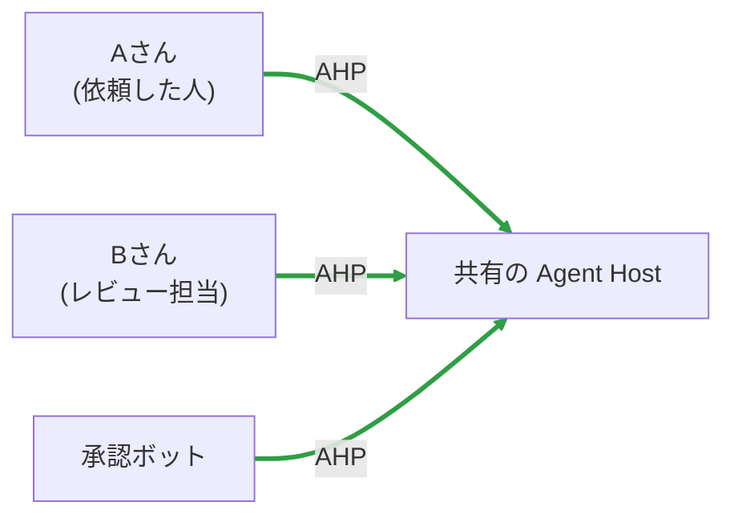

# ユースケース集

よくある「やりたいこと」を、どのプロトコルで実現するかを図で示します。自分の状況に近いものを探してみてください。

## 1. 普段のエディタで、最新のエージェントを試したい

ACP

**やること**: ACP Registry からエージェントを入れて、チャット画面で切り替えるだけ。
**ポイント**: エディタを乗り換えずに、エージェントだけを比べられます。

---

## 2. 長い作業を任せて、外出先から様子を見たい

AHP + ACP

**やること**: 開発機で Agent Host を動かし、セッションを始める。外出先からはブラウザでつなぐ。
**ポイント**: 実行の承認が必要になったら、どの画面からでも答えられます。

---

## 3. 社内の専門エージェントを組み合わせたい

A2A

**やること**: 各部署がエージェントを A2A で公開し、窓口エージェントがスキルを見て振り分ける。
**ポイント**: 部署ごとに別の LLM・別のフレームワークで作られていても、名刺さえあれば連携できます。

---

## 4. 外部の専門サービスに一部の仕事を外注したい

A2A + MCP

**やること**: 相手の名刺の認証方式に従ってトークンを取り、A2A で依頼する。社内データは MCP で読む。
**ポイント**: 相手は opaque なので、**社内データの何を渡すか**は自分の側で決めて絞り込みます。

---

## 5. 何日もかかるバッチ処理を頼みたい

A2A (プッシュ通知)

**やること**: 相手の名刺で `pushNotifications: true` を確認し、通知先を渡して依頼する。
**ポイント**: 接続を開いたまま待つ必要がありません。

---

## 6. チームで 1 つのエージェント作業を見守りたい

AHP

**やること**: 共有のホストにセッションを置き、全員がそのチャンネルを購読する。
**ポイント**: 誰が承認したか、どの順番で何が起きたかが、通し番号つきで全員に同じように見えます。

---

!!! question "自分のユースケースを整理するワーク"
    次の 4 つを紙に書き出してみましょう。

    1. **誰が** (人? システム?) 使うか
    2. **どの画面**から使うか (エディタ? ブラウザ? 複数?)
    3. **誰に**仕事をさせるか (自分のエージェント? 他人のエージェント?)
    4. **何を**道具として使わせるか (DB? API? ファイル?)

    2 → ACP / AHP、3 → A2A、4 → MCP と対応させれば、必要なプロトコルが揃います。

[次へ: 組み合わせる :material-arrow-right:](combine.md){ .md-button .md-button--primary }
